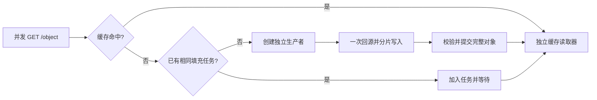

# Razor

**Razor 是一个用 Go 实现、借鉴 Apache Traffic Server 缓存架构的 HTTP 对象缓存代理。** 面向下载与分发场景，重点解决热点对象重复回源、大文件区间复用，以及取消、失效和重启时的缓存正确性。

当前版本使用 `net/http`，支持整对象合并回源、可配置块的 Range/公共静态大 GET 缓存与提交后 RWW、磁盘缓存恢复、鉴权 PURGE、TLS/HTTP/2 和配置快照热更新。定位为具有真实二进制验收证据的单进程缓存代理；生产容量仍需在目标硬件上测量。

功能状态以本 README 和对应版本的验收报告为准，早期设计与状态文档保留供追溯。

## 核心能力

| 能力 | 当前行为 |
| --- | --- |
| 合并回源 | 缓存 MISS 后、访问源站前登记共享任务；相同任务的并发请求共享一次填充，完整提交后各自读取缓存 |
| 独立生命周期 | 首个客户端取消不影响其他订阅者；全部订阅者离开时取消回源；任务数、订阅者数、超时和写缓冲均有预算 |
| 部分缓存 | 单 Range 与公共静态合格大 GET 共用可配置块（默认 1 MiB）；固定源站、强 ETag、布局和失效代次，首块提交后发送，重叠请求只补缺块 |
| HTTP 缓存语义 | 保守准入、GET/HEAD、受支持的 Vary 变体、Age/新鲜度、条件请求和源站 304 重验证；私有及不支持的响应旁路 |
| 持久缓存 | stripe 文件、目录索引、聚合写缓冲和 RAM cache；CRC/长度/身份校验，片段写入完成后才发布完整对象 |
| 恢复与失效 | 干净关闭后的检查点恢复；异常退出时不把不可信片段作为 HIT；PURGE 失效代次阻止旧填充重新发布 |
| 运行治理 | 连接、请求、回源和缓存写入的限额与有界排队；阶段超时、优雅排空、结构化访问日志及本地资源快照 |
| 代理与配置 | TLS/HTTP/2、源站证书校验、显式可信代理、主动健康检查；SIGHUP 校验并发布配置快照，已有请求保持原快照 |

## 合并回源如何工作



默认模式的任务身份包含缓存命名空间、方法、Host、客户端 IP、完整请求头、TLS 状态和配置版本，只合并这些条件等价的请求。

公共静态源站可显式配置 `CONFIG proxy.config.cache.shared_fill_public_static INT 1`（默认 0，重启生效）。此模式要求源站不按客户端身份生成不同内容：生产者使用固定 `User-Agent: Razor`，移除真实客户端 IP、Forwarded/X-Forwarded-For/X-Real-IP 和追踪头，保留可信代理解析后的 scheme/Host。不同 IP、UA、追踪信息的等价冷请求可以合并；未知头仍参与任务身份并发给源站，Accept-Encoding/Accept-Language 的不同值保持隔离。持久缓存继续遵守源站声明的这两个 Vary 维度；不支持的 Vary 不共享。块布局按原始 Accept-Encoding/Accept-Language 分别隔离，包括缺省编码和显式 identity。不同保守任务竞争同一个 manifest 或块时，只有取得写预留的任务可以回源，冲突任务受控失败，避免重复源站生产者及未知头错误共享。

100/200 MiB 公共分块对象需要显式提高对象准入上限（默认仅 64 MiB）：

```text
CONFIG proxy.config.cache.shared_fill_public_static INT 1
CONFIG proxy.config.cache.max_object_bytes INT 268435456
CONFIG proxy.config.cache.range_block_bytes INT 1048576
```

Authorization/Cookie 等旁路请求保留原代理行为。公共模式使用独立、版本化内容命名空间；切换模式安全 MISS，不删除旧文件。该能力已通过服务级回归，专用测试机上已完成本次两策略/HDD/SSD矩阵和两次全新SSD两小时实测，证据见下文 #19 报告。

生产者不依赖首个客户端继续存活。PURGE 后的新请求不能加入旧任务，旧任务也不能重新发布缓存。如果源站响应不可共享，正文仅交付给原始创建者，其他订阅者受控失败，不并发重试源站。普通整对象路径仍等待完整提交。公共静态模式下，identity 编码、强 ETag、可共享且大于 `max(1 MiB, range_block_bytes)` 的完整 GET 与单 Range 共用块：首个所需块完整校验并提交后开始发送，发送当前块时最多预取本区间下一块。小文件保留整对象路径；冷 GET 可增加一次共享 HEAD 分类，不为每块重复 HEAD。

`CONFIG proxy.config.cache.range_block_bytes INT 1048576` 支持 64 KiB–8 MiB 的 2 的幂，重启生效，SIGHUP 改变会被拒绝。块大小与格式进入 manifest/块身份；此轮使用 v2 布局，对旧 v1 块安全 MISS，保留旧文件。完整 fresh Range 可在全部源站不健康时离线读取；缺块或过期时仍需可用源站，整次响应固定一个源站和版本。

发送缓冲与生产者 staging 都计入 `write_buffer_bytes` 的保守预留；额度不足跳过预取，发送完当前块先释放读缓冲，再等待后块，磁盘容量按至多两块窗口检查。`Stats` 的 `RangeBlockHits/Misses` 是各读者已准备块的逻辑命中，`RangeHitBytes/MissBytes` 是已准备请求区间的尝试字节（不代表实际网络或唯一回源字节）；源站实际正文另见 `Origin.Bytes`。请求只有全部块复用且完整成功才计 HIT。发送前失败返回受控错误；发送后失败、PURGE 或版本变化会中断流，客户端必须检查正文读取错误与 Content-Length。合成响应保守使用 `Cache-Control: no-cache`；提交不等于每块 fsync，不读取未提交字节。服务级回归已验证，本轮 HDD/SSD 三轮矩阵与两策略全新 SSD 各两小时实测已通过，完整范围和限制见 #19 报告。

## 快速开始

要求：Go **1.26.10**（见 `go.mod`）；下面的示例另需 Bash、Python 3 和 curl。真实二进制端到端验收工具要求 Linux、Python **3.9+**。

```bash
make build
./razor -h
./razor -v
```

`-c` 指向同时包含 `records.config` 和 `storage.config` 的**目录**。下面创建独立临时配置、源文件和缓存，端口分别为 8080、8081；文件会保留供检查。

在第一个终端中运行：

```bash
RAZOR_DEMO_DIR=$(mktemp -d "${TMPDIR:-/tmp}/razor-demo.XXXXXX")
mkdir -p "$RAZOR_DEMO_DIR"/{conf,origin,logs}
printf 'hello from razor\n' > "$RAZOR_DEMO_DIR/origin/object.txt"

cat > "$RAZOR_DEMO_DIR/conf/records.config" <<EOF
CONFIG proxy.config.http.server_ports INT 8080
CONFIG proxy.config.log.logfile_dir STRING $RAZOR_DEMO_DIR/logs
CONFIG proxy.config.http.parent_proxy.upstream_algo STRING round-robin
CONFIG proxy.config.http.parent_proxy.upstream_targets STRING http://127.0.0.1:8081
CONFIG proxy.config.cache.max_object_bytes INT 268435456
EOF
printf '%s 1G\n' "$RAZOR_DEMO_DIR/cache.db" > "$RAZOR_DEMO_DIR/conf/storage.config"

python3 -u - "$RAZOR_DEMO_DIR/origin" <<'PY' &
import http.server
import os
import sys

os.chdir(sys.argv[1])
class Origin(http.server.SimpleHTTPRequestHandler):
    def end_headers(self):
        self.send_header("Cache-Control", "public, max-age=3600")
        super().end_headers()

http.server.HTTPServer(("127.0.0.1", 8081), Origin).serve_forever()
PY
ORIGIN_PID=$!
trap 'kill "$ORIGIN_PID" 2>/dev/null || true' EXIT
until curl -fsSI http://127.0.0.1:8081/object.txt >/dev/null 2>&1; do sleep .1; done
printf 'Demo directory: %s\n' "$RAZOR_DEMO_DIR"
./razor -c "$RAZOR_DEMO_DIR/conf"
```

在第二个终端中连续请求：

```bash
curl -fsS http://127.0.0.1:8080/object.txt
curl -fsS http://127.0.0.1:8080/object.txt
```

两次均返回 `hello from razor`。源站只出现一次 GET，示例目录的 `logs/access.log` 依次记录 `cache_status=MISS/HIT`（JSON 字段）。按 Ctrl-C 停止 Razor 后，执行 `kill "$ORIGIN_PID"` 停止示例源站；退出该 shell 时也会触发清理。该简易源站用于演示整对象缓存，Range 请使用下面的验收工具验证。

RAM 默认使用 Otter v2.2.1，每 stripe 10 MiB；可选 `s3-fifo`，两者均是磁盘之上的可丢弃加速层。

```text
CONFIG proxy.config.cache.ram_cache_algorithm STRING otter
CONFIG proxy.config.cache.ram_cache_bytes INT 10485760
```

算法只接受 `otter` / `s3-fifo`；预算为每 stripe 的序列化 cache value 权重字节（包括 Doc/HTTP 元数据、manifest 及正文），`0` 禁用，最大 1 TiB。两项重启生效，SIGHUP 改变会拒绝并保留现服务。策略切换保留磁盘文件及其身份，不新增读盘 promotion。空值预留 1 字节，过大值/超过 64 KiB 的 key 跳过 RAM 并安全回退磁盘；该 value 字节预算不包括外部节点、key、ghost 与 Go runtime，不能当作 RSS 限额。算法变体、边界及公平基准入口见 [RAM 缓存策略](docs/RAM_CACHE.md)。本轮硬件和两策略各两小时实测已通过；结果限于所测工作负载，不宣称 S3-FIFO 普遍优于默认策略。

完整配置项及热更新边界见 [conf/records.config](conf/records.config)。默认整对象限额为 64 MiB；示例将其调整为 256 MiB，约 200 MiB 对象的测试也需配置足够缓存容量。`write_buffer_bytes` 是写入预算，不是进程 RSS 上限。

## 验证与复现

```bash
make test
make test-race
go vet ./...
python3 -m unittest discover -s tools -p '*_test.py'
```

不依赖 ATS 的真实二进制验收：

```bash
python3 tools/acceptance.py \
  --binary "$PWD/razor" \
  --output /path/to/test-disk/razor-functional-unique-run \
  --large-mib 100 \
  --mode functional
```

`--output` 必须尚不存在。工具自行启动源站和服务进程，生成 256 KiB 小文件及指定大小的常规文件，使用 64 KiB 流式客户端校验长度与 SHA256，保留配置、源站计数、请求及故障证据；运行前预留数 GiB 空间。`--large-mib` 支持 100/200，默认 100，200 MiB 用于兼容回归。

同时执行功能矩阵与 Razor 独立压测，可将缓存放在另一块盘上：

```bash
python3 tools/acceptance.py \
  --binary "$PWD/razor" \
  --output /path/to/results/razor-cdn-unique-run \
  --cache-root /path/to/cache-disk/razor-cdn-unique-run \
  --products razor --large-mib 100 \
  --mode all --seconds 10 --repeats 3
```

`--cache-root` 也必须尚不存在，工具不会清理已有缓存。压测包括热缓存、冷热门对象、唯一长尾 URL、混合大小对象、Range、慢源站与慢客户端；混合负载按每个客户端洗牌后的加权 URL 列表循环，实际比例记录在结果中。ATS 对照入口也在该工具中，但现有适配器面向 **ATS 9.2 的 records.config/runroot**；ATS 10.2 的环境适配尚未验收，不能直接宣称可用。

公共静态模式与两 RAM 策略使用以下独立入口；替换 `RUN` 为唯一 run-id，按策略、介质顺序运行，勿与 hey 竞争机器：

```bash
python3 tools/acceptance.py --binary "$PWD/razor" \
  --output /path/to/results/RUN --cache-root /path/to/cache/RUN \
  --products razor --public-static --ram-algorithm otter --ram-bytes 10485760 \
  --block-bytes 1048576 --large-mib 100 --mode public-functional
# 同一参数改 --mode benchmark --seconds 10 --repeats 3；每个入口用新的目录。
# 两次独立 SSD 长稳态：otter / s3-fifo 各 --mode soak --soak-seconds 7200。
```

公共功能入口验证真实首块屏障、后块错误正文、100 个 loopback TCP 源 IP/UA/trace、重叠区间、GET/Range 复用、取消排空、重启/PURGE、离线和布局切换。`--block-bytes 65536` / `4194304` 分别验证布局；`--large-mib 200` 验证兼容。保守路径用 `--mode functional`，始终关闭公共模式。不同源站同 ETag、版本/If-Range/416、磁盘位翻转、限额和精确预取边界另由真实 HTTP/磁盘 Go 回归覆盖；不能把这些服务级测试写成已经执行的硬件场景。

soak 在整个时段持续执行有界工作集的热点、长尾、Range 拖动/重叠、完整 GET、慢源/客户端与受控冷 MISS，每个成功响应检查长度/SHA256。`progress.json` 包含 PID、UTC 起点、阶段和请求数，`soak-stages.jsonl`/`requests.jsonl`/`origin-soak.jsonl` 保存原始记录；`soak-outcome.json` 只有实际运行至少两小时才标记 `qualifies_two_hour_soak=true`。`--allow-short-soak` 仅用于冒烟。最终任务、等待者、写者、读者、缓存队列、origin 和预留缓冲必须归零。工具不接管后台守护，长任务由调用方以持久进程启动并检查 outcome。

SIGUSR1 保留旧统计行并增加带采样时刻的 JSON：请求/块/逻辑区间字节命中与 RAM lookup 分开计数，源站 HEAD/GET/实际正文从 origin 原始记录取得，`/proc` 记录 PID、CPU、读写、RSS、FD，并按缓存文件 st_dev 采样设备 sectors×512 与 I/O 毫秒（overlay 无法映射则为 null；设备计数包含其他进程背景活动），JSON 另含 heap/GC、goroutine、RAM resident/ghost/估算元数据和任务/缓冲。`batches.json` 含吞吐、TTFB/完成 P99、每 GiB CPU、实际磁盘写入/源站正文比；采样峰值不是硬上限，缓存写放大也包含日志写入。跨重启按 PID 分段，不能直接相减累积计数。已观察到当前 manifest 版本改变时，旧流停止后续块；普通 manifest 淘汰只表示未知，仍由固定强 ETag 校验保护。所有压测为同机 HTTP/1.1 loopback，不代表分布式 WAN、TLS/H2 负载或 ATS 10.2 性能优势。

另提供 [hey 交叉测量工具](tools/hey_benchmark.py)，复用同一源站、进程和采样机制，减少 Python 客户端对吞吐的影响。原版 hey v0.1.4 忽略正文读取错误，故使用 [独立构建脚本](tools/build_hey.py) 补上一行实际读取字节和错误记账，并以真实截断源站回归验证。每批前后验证 SHA256；压测客户端逐响应读取正文并报告读取错误，批次汇总实际字节，不逐响应计算 hash。工具校验构建清单和二进制 hash，拒绝误用未修正版。

工具还在恢复完成后，对本项目静止的缓存文件执行 `fsync`/`POSIX_FADV_DONTNEED`，并要求实际读盘字节达到对象大小的 99%，单独验证近全量物理冷读。逐出是建议，不能假定每一页均被清除。

```bash
python3 tools/build_hey.py --output /path/to/tools/hey-checked
RAZOR_CHECKED_HEY=/path/to/tools/hey-checked \
  python3 -m unittest discover -s tools -p '*_test.py'
python3 tools/hey_benchmark.py \
  --binary "$PWD/razor" --hey /path/to/tools/hey-checked \
  --fixtures /path/to/results/razor-cdn-unique-run/fixtures \
  --output /path/to/results/razor-hey-unique-run \
  --cache-root /path/to/cache-disk/razor-hey-unique-run \
  --seconds 10 --repeats 3
```

本轮公共分块缓存的 [专机验收报告](docs/benchmarks/CDN_ACCEPTANCE_2026-10-21.md) 基于测量源码 `5ccf32c`：24项功能/布局/三轮主压力/checked-hey/物理文件冷读及两策略各一次全新SSD ≥7200秒长测，**全部26项实测通过**。四次历史中止/失败及修复均在报告保留；旧 `12571fc` 的 Otter 两小时虽通过，S3-FIFO 约 100 分钟时截断导致该次整体验收失败，旧时间不抵扣两次新长测。

| 本轮场景 | 修复版已完成实测结果 |
| --- | --- |
| HDD/SSD × 两 RAM 策略主压力 | 228 批、664,149 个逐响应长度/SHA 校验请求，非预期错误 0；主动限额功能的 120 个预期 503 单列 |
| checked-hey 交叉测量 | 48 批、2,776,124 个实际正文读取/字节检查请求，每批前后 SHA；另有 12 次物理文件冷读通过 |
| 100 个实际 TCP IP/UA/trace 公共冷请求 | 默认1MiB布局、100MiB主测：所需块一个正文生产者；HEAD 1、GET 1、正文 1 MiB |
| 100 MiB 公共完整 GET 冷突发 | 默认1MiB布局：每轮 HEAD 1+块 GET 100、正文 100 MiB；不同于历史整对象 GET 1 次 |
| 重叠区间 | 功能正文并集 24 MiB，第二次只补 8 MiB；压力四个区间并集 28 MiB |
| 吞吐/时延与资源 | 两策略/两介质均三轮完整保留；HDD/S3 拖动 r2 的 50.88 MiB/s 波动未剔除，原因未证实；Otter 的 HDD矩阵/SSD长测 ResidentBytes 快照分别10.53/10.76 MiB，超过配置10MiB；弱一致采样不证明同刻精确驻留量或同步硬预算违约，预算也不是RSS限额 |
| 两策略全新 SSD 长测 | Otter 7200.279144秒/122,666 GET，S3-FIFO 7200.089907秒/123,096 GET；非预期错误0、最终活动与Origin队列均排空 |
| 长测分类与资源 | 未分类GET分别26/30、Bypass均0，原因未证实；RSS采样峰69.82/70.18MiB，累计分配及GC成本完整保留于报告 |
| 文档交付 | 最终准确性审查、交付提交及其CI由Git/Issue外部证据记录，测量源码与后续文档提交区分 |

以上为同机 HTTP/1.1 loopback 结果，不代表 WAN、TLS/H2 压力或裸盘吞吐。缓存文件小于主机 RAM，warm 磁盘路径可能是 OS page cache。历史 [2026-10-21 保守整对象报告](docs/BENCHMARK_2026-10-21.md) 与 [2026-10-20 /200 MiB/ATS 9.2.3 报告](docs/ACCEPTANCE_2026-10-20.md) 保留；旧冷整对象/并集和吞吐数字不冒充新公共块路径结果。测试机见 [测试环境](docs/TEST_ENVIRONMENT.md)。

## 当前边界

- 只对明确可共享、受支持的响应进行缓存；不宣称完整实现所有 HTTP 缓存指令。Authorization/Cookie 请求旁路；HEAD MISS 直接访问源站。
- Range 面向具有稳定强 ETag 的 identity 表示和单区间请求；不做任意 206 响应的通用缓存，也不提供多 Range 块缓存。
- 所有源站被健康检查摘除时，fresh 完整对象及完整 fresh Range 区间仍可 HIT；缺块、过期、损坏区间受控失败，不启用已移除的源站。
- 普通整对象路径等待完整提交；块级 RWW 等待首块提交，不读取未校验/未提交字节。没有 stale-if-error、跨节点缓存一致性或 io_uring 后端。
- 文件写入完成不等同于逐对象 fsync；异常退出可能安全冷启动相关 stripe。缓存文件需保持单进程独占，格式及恢复约束见 [存储格式](docs/CACHE_STORAGE_FORMAT.md)。

本轮离线 Range、公共静态合并、提交后 RWW 和可选 RAM 策略已完成实现；两次旧版本长测失败修复后，5ccf32c 新源码24项矩阵与两策略全新SSD各两小时，共26项实测通过；最终文档审查及交付提交的CI仍是交付门槛，见 [HDD/SSD 与 soak 验收 #19](https://github.com/Monsterwi/bakemono/issues/19)。[性能剖析 #18](https://github.com/Monsterwi/bakemono/issues/18)、内核升级和 io_uring 不纳入本轮。

## 项目结构

```text
server/          HTTP 缓存决策、共享任务、Range、运行快照与排空
proxy/           源站连接、转发身份、限额、TLS 与健康检查
cache/           stripe 存储、提交/恢复、失效代次、RAM 与写缓冲
config/          records.config/storage.config 解析与发布前校验
internal/budget/ 有界并发、排队及取消
tools/           真实二进制端到端与压力验证
```

项目名称由 Bakemono 统一为 Razor，Go 模块路径已经是 `github.com/Monsterwi/razor`。当前 GitHub 地址仍为 [Monsterwi/bakemono](https://github.com/Monsterwi/bakemono)，需求继续使用该仓库的 Issues 管理；总计划 [#1](https://github.com/Monsterwi/bakemono/issues/1) 保持打开。

构建输出改为 `razor`，默认日志目录改为 `/var/log/razor`，默认 PID 文件改为 `/var/run/razor.pid`。已有配置显式指定的路径继续生效，旧缓存不会因改名被搬迁或删除；需要保留旧 PID 路径时使用 `-p`。历史报告保留当时的产品名与文件位置，以便追溯。
