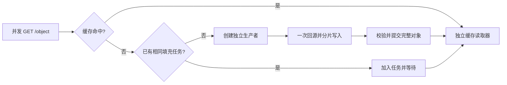

# Razor

**Razor 是一个用 Go 实现、借鉴 Apache Traffic Server 缓存架构的 HTTP 对象缓存代理。** 面向下载与分发场景，重点解决热点对象重复回源、大文件区间复用，以及取消、失效和重启时的缓存正确性。

当前版本使用 `net/http`，支持整对象合并回源、1 MiB 固定块 Range 缓存、磁盘缓存恢复、鉴权 PURGE、TLS/HTTP/2 和配置快照热更新。定位为具有真实二进制验收证据的单进程缓存代理；生产容量仍需在目标硬件上测量。

功能状态以本 README 和对应版本的验收报告为准，早期设计与状态文档保留供追溯。

## 核心能力

| 能力 | 当前行为 |
| --- | --- |
| 合并回源 | 缓存 MISS 后、访问源站前登记共享任务；相同任务的并发请求共享一次填充，完整提交后各自读取缓存 |
| 独立生命周期 | 首个客户端取消不影响其他订阅者；全部订阅者离开时取消回源；任务数、订阅者数、超时和写缓冲均有预算 |
| 部分缓存 | 单 Range 请求拆成 1 MiB 块；用固定源站、强 ETag、表示和块位置隔离版本，重叠请求复用已有块和在途任务 |
| HTTP 缓存语义 | 保守准入、GET/HEAD、受支持的 Vary 变体、Age/新鲜度、条件请求和源站 304 重验证；私有及不支持的响应旁路 |
| 持久缓存 | stripe 文件、目录索引、聚合写缓冲和 RAM cache；CRC/长度/身份校验，片段写入完成后才发布完整对象 |
| 恢复与失效 | 干净关闭后的检查点恢复；异常退出时不把不可信片段作为 HIT；PURGE 失效代次阻止旧填充重新发布 |
| 运行治理 | 连接、请求、回源和缓存写入的限额与有界排队；阶段超时、优雅排空、结构化访问日志及本地资源快照 |
| 代理与配置 | TLS/HTTP/2、源站证书校验、显式可信代理、主动健康检查；SIGHUP 校验并发布配置快照，已有请求保持原快照 |

## 合并回源如何工作



任务身份包含缓存命名空间、方法、Host、客户端 IP、完整请求头、TLS 状态和配置版本。当前只合并这些条件等价的请求，避免未知 Vary 或源站身份相关响应被错误共享；不同 IP 或请求头之间的合并尚未支持。

生产者不依赖首个客户端继续存活。PURGE 后的新请求不能加入旧任务，旧任务也不能重新发布缓存。如果源站响应不可共享，正文仅交付给原始创建者，其他订阅者受控失败，不并发重试源站。完整对象和 Range 请求均等待所需数据提交后再发送正文，尚未提供 HTTP 层边写边读。

## 快速开始

要求：Go **1.26.10**（见 `go.mod`）；下面的示例另需 Bash、Python 3 和 curl。真实二进制端到端验收工具要求 Linux、Python **3.9+**。

```bash
make build
./razor -h
./razor -v
```

`-c` 指向同时包含 `records.config` 和 `storage.config` 的**目录**。下面创建独立临时配置、源文件和缓存，端口分别为 8080、8081；文件会保留供检查。

在第一个终端中运行：

```bash
RAZOR_DEMO_DIR=$(mktemp -d "${TMPDIR:-/tmp}/razor-demo.XXXXXX")
mkdir -p "$RAZOR_DEMO_DIR"/{conf,origin,logs}
printf 'hello from razor\n' > "$RAZOR_DEMO_DIR/origin/object.txt"

cat > "$RAZOR_DEMO_DIR/conf/records.config" <<EOF
CONFIG proxy.config.http.server_ports INT 8080
CONFIG proxy.config.log.logfile_dir STRING $RAZOR_DEMO_DIR/logs
CONFIG proxy.config.http.parent_proxy.upstream_algo STRING round-robin
CONFIG proxy.config.http.parent_proxy.upstream_targets STRING http://127.0.0.1:8081
CONFIG proxy.config.cache.max_object_bytes INT 268435456
EOF
printf '%s 1G\n' "$RAZOR_DEMO_DIR/cache.db" > "$RAZOR_DEMO_DIR/conf/storage.config"

python3 -u - "$RAZOR_DEMO_DIR/origin" <<'PY' &
import http.server
import os
import sys

os.chdir(sys.argv[1])
class Origin(http.server.SimpleHTTPRequestHandler):
    def end_headers(self):
        self.send_header("Cache-Control", "public, max-age=3600")
        super().end_headers()

http.server.HTTPServer(("127.0.0.1", 8081), Origin).serve_forever()
PY
ORIGIN_PID=$!
trap 'kill "$ORIGIN_PID" 2>/dev/null || true' EXIT
until curl -fsSI http://127.0.0.1:8081/object.txt >/dev/null 2>&1; do sleep .1; done
printf 'Demo directory: %s\n' "$RAZOR_DEMO_DIR"
./razor -c "$RAZOR_DEMO_DIR/conf"
```

在第二个终端中连续请求：

```bash
curl -fsS http://127.0.0.1:8080/object.txt
curl -fsS http://127.0.0.1:8080/object.txt
```

两次均返回 `hello from razor`。源站只出现一次 GET，示例目录的 `logs/access.log` 依次记录 `cache_status=MISS/HIT`（JSON 字段）。按 Ctrl-C 停止 Razor 后，执行 `kill "$ORIGIN_PID"` 停止示例源站；退出该 shell 时也会触发清理。该简易源站用于演示整对象缓存，Range 请使用下面的验收工具验证。

RAM 默认使用 Otter v2.2.1，每 stripe 10 MiB；可选 `s3-fifo`，两者均是磁盘之上的可丢弃加速层。

```text
CONFIG proxy.config.cache.ram_cache_algorithm STRING otter
CONFIG proxy.config.cache.ram_cache_bytes INT 10485760
```

算法只接受 `otter` / `s3-fifo`；预算为每 stripe 的正文权重字节，`0` 禁用，最大 1 TiB。两项重启生效，SIGHUP 改变会拒绝并保留现服务。策略切换保留磁盘文件及其身份，不新增读盘 promotion。空值预留 1 字节，过大值/超过 64 KiB 的 key 跳过 RAM 并安全回退磁盘；字节预算不包括节点、key、ghost 与 Go runtime，不能当作 RSS 限额。算法变体、边界及公平基准入口见 [RAM 缓存策略](docs/RAM_CACHE.md)。本轮硬件/soak 验收完成前不宣称 S3-FIFO 性能优于默认策略。

完整配置项及热更新边界见 [conf/records.config](conf/records.config)。默认整对象限额为 64 MiB；示例将其调整为 256 MiB，约 200 MiB 对象的测试也需配置足够缓存容量。`write_buffer_bytes` 是写入预算，不是进程 RSS 上限。

## 验证与复现

```bash
make test
make test-race
go vet ./...
python3 -m unittest discover -s tools -p '*_test.py'
```

不依赖 ATS 的真实二进制验收：

```bash
python3 tools/acceptance.py \
  --binary "$PWD/razor" \
  --output /path/to/test-disk/razor-functional-unique-run \
  --large-mib 100 \
  --mode functional
```

`--output` 必须尚不存在。工具自行启动源站和服务进程，生成 256 KiB 小文件及指定大小的常规文件，使用 64 KiB 流式客户端校验长度与 SHA256，保留配置、源站计数、请求及故障证据；运行前预留数 GiB 空间。`--large-mib` 支持 100/200，默认 200 以保留历史基线的复现方式。

同时执行功能矩阵与 Razor 独立压测，可将缓存放在另一块盘上：

```bash
python3 tools/acceptance.py \
  --binary "$PWD/razor" \
  --output /path/to/results/razor-cdn-unique-run \
  --cache-root /path/to/cache-disk/razor-cdn-unique-run \
  --products razor --large-mib 100 \
  --mode all --seconds 10 --repeats 3
```

`--cache-root` 也必须尚不存在，工具不会清理已有缓存。压测包括热缓存、冷热门对象、唯一长尾 URL、混合大小对象、Range、慢源站与慢客户端；混合负载按每个客户端洗牌后的加权 URL 列表循环，实际比例记录在结果中。ATS 对照入口也在该工具中，但现有适配器面向 **ATS 9.2 的 records.config/runroot**；ATS 10.2 的环境适配尚未验收，不能直接宣称可用。

另提供 [hey 交叉测量工具](tools/hey_benchmark.py)，复用同一源站、进程和采样机制，减少 Python 客户端对吞吐的影响。原版 hey v0.1.4 忽略正文读取错误，故使用 [独立构建脚本](tools/build_hey.py) 补上一行实际读取字节和错误记账，并以真实截断源站回归验证。每批前后验证 SHA256；压测客户端逐响应读取正文并报告读取错误，批次汇总实际字节，不逐响应计算 hash。工具校验构建清单和二进制 hash，拒绝误用未修正版。

工具还在恢复完成后，对本项目静止的缓存文件执行 `fsync`/`POSIX_FADV_DONTNEED`，并要求实际读盘字节达到对象大小的 99%，单独验证近全量物理冷读。逐出是建议，不能假定每一页均被清除。

```bash
python3 tools/build_hey.py --output /path/to/tools/hey-checked
RAZOR_CHECKED_HEY=/path/to/tools/hey-checked \
  python3 -m unittest discover -s tools -p '*_test.py'
python3 tools/hey_benchmark.py \
  --binary "$PWD/razor" --hey /path/to/tools/hey-checked \
  --fixtures /path/to/results/razor-cdn-unique-run/fixtures \
  --output /path/to/results/razor-hey-unique-run \
  --cache-root /path/to/cache-disk/razor-hey-unique-run \
  --seconds 10 --repeats 3
```

本轮 100 MiB 交付的完整数据、版本与边界见 [2026-10-21 压测报告](docs/BENCHMARK_2026-10-21.md)：

| 场景 | 实测结果 |
| --- | --- |
| HDD/SSD 主矩阵 | 94 批、342,271 请求，批次非预期错误 0；其中 60 个主动限额 503 单列 |
| 独立 Go 客户端交叉测量 | 正文读取检查版 hey：24 批、1,680,294 个热缓存请求，实际读取字节及错误校验通过；每批前后 hash 一致 |
| 100 个等价小文件冷请求 | 仅回源 1 次 / 256 KiB |
| 32 个等价 100 MiB 冷请求 | 仅回源 1 次 / 100 MiB |
| 8 个并发重叠 Range | 返回合计 128 MiB，只获取 40 MiB 区间并集，另有 1 次 HEAD；后续热请求新增回源 0 |
| 256 KiB / 32 并发热缓存 | hey 中位 QPS：HDD 14,495.49 / SSD 14,430.41 |
| 100 MiB / 8 并发热缓存 | hey 中位吞吐：HDD 3982.59 / SSD 4377.74 MiB/s |

上述热缓存数字为 32 逻辑核测试机、服务 GOMAXPROCS=8 下的同机 loopback 结果，主要命中 RAM/OS page cache，不能写成公网 CDN 带宽或生产容量。报告另列实际发生块 I/O 的缓存冷读，不混为一种指标。测试机路径见 [测试环境](docs/TEST_ENVIRONMENT.md)；历史 200 MiB / ATS 9.2.3 对照见 [旧报告](docs/ACCEPTANCE_2026-10-20.md)，两台机器的数字不直接计算提升比例。

## 当前边界

- 只对明确可共享、受支持的响应进行缓存；不宣称完整实现所有 HTTP 缓存指令。Authorization/Cookie 请求旁路；HEAD MISS 直接访问源站。
- Range 面向具有稳定强 ETag 的 identity 表示和单区间请求；不做任意 206 响应的通用缓存，也不提供多 Range 块缓存。
- 所有源站被健康检查摘除时，fresh 完整对象仍可 HIT，但已缓存的 Range 当前会返回 502。这是下一步优先修复的可用性问题。
- 完整提交后交付会增加冷大对象的首字节等待。没有流式 RWW、stale-if-error、跨节点缓存一致性或 io_uring 后端。
- 文件写入完成不等同于逐对象 fsync；异常退出可能安全冷启动相关 stripe。缓存文件需保持单进程独占，格式及恢复约束见 [存储格式](docs/CACHE_STORAGE_FORMAT.md)。

后续优先收敛已有能力：[修复离线源站下的 Range HIT](https://github.com/Monsterwi/bakemono/issues/16)、[明确合并回源的请求等价边界](https://github.com/Monsterwi/bakemono/issues/17)、[依据剖析完成一项效率优化](https://github.com/Monsterwi/bakemono/issues/18)。流式 RWW、内核升级和 io_uring 暂不进入这一版。

## 项目结构

```text
server/          HTTP 缓存决策、共享任务、Range、运行快照与排空
proxy/           源站连接、转发身份、限额、TLS 与健康检查
cache/           stripe 存储、提交/恢复、失效代次、RAM 与写缓冲
config/          records.config/storage.config 解析与发布前校验
internal/budget/ 有界并发、排队及取消
tools/           真实二进制端到端与压力验证
```

项目名称由 Bakemono 统一为 Razor，Go 模块路径已经是 `github.com/Monsterwi/razor`。当前 GitHub 地址仍为 [Monsterwi/bakemono](https://github.com/Monsterwi/bakemono)，需求继续使用该仓库的 Issues 管理；总计划 [#1](https://github.com/Monsterwi/bakemono/issues/1) 保持打开。

构建输出改为 `razor`，默认日志目录改为 `/var/log/razor`，默认 PID 文件改为 `/var/run/razor.pid`。已有配置显式指定的路径继续生效，旧缓存不会因改名被搬迁或删除；需要保留旧 PID 路径时使用 `-p`。历史报告保留当时的产品名与文件位置，以便追溯。
