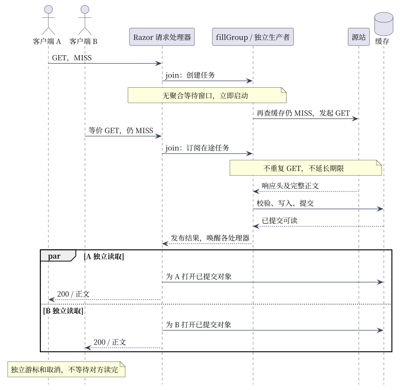
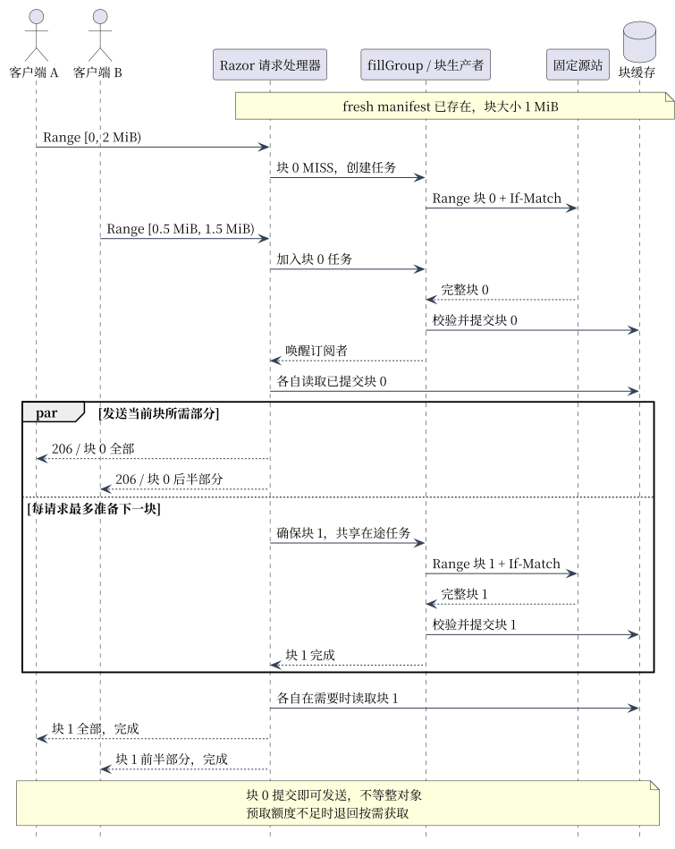

# 合并回源与原生部分对象缓存

[架构](ARCHITECTURE.md) · [RWW 管线](RWW_IMPLEMENTATION.md) · [存储提交](CACHE_STORAGE_FORMAT.md)。

## 整对象合并时序

等价并发 MISS 共享一个独立生产者，完成后各自读取；图中省略额度排队与失败分支。

| 规则 | 行为 |
| --- | --- |
| 聚合窗口 | 无人为延迟；首请求立即启动，后来的加入在途任务 |
| 等待时间 | 若 0 ms 创建、20 ms 加入、100 ms 提交，两者约等 100/80 ms；不是实测值 |
| 期限 | 默认 300 秒，从任务创建计时；加入不续期，其他超时可能更早失败 |
| 取消 | 独立取消；最后订阅者离开才取消生产者；首客户端不拥有共享 Context |
| 额度 | 默认 16 个任务、每任务 256 个订阅者（含创建者）；过载受控拒绝 |
| 私有响应 | 仅交给仍等待的创建者；其他订阅者失败，不立即各自重试回源 |

[fillGroup](../server/fill_group.go) 原子 join；生产者启动后再查缓存，避免竞争期间重复填充。它协调尚未有 Writer 的请求；缓存层 OpenDir 另管写入所有权。

## 共享身份

| 身份 | 组成 |
| --- | --- |
| URL 根键 v3 | 配置命名空间、有效 scheme/Host、原始转义路径、排序后的原始 query 项 |
| 整对象表示键 | 根键、受支持的 Vary 字段和值 |
| 在途任务键 | 填充键、方法、Host、peer IP、请求头、TLS 状态、runtime version |
| 块键 | 根键、完整源站、变体、强 ETag、随机 Incarnation、布局/块大小、块号 |
| FillToken | 回源前失效凭证；块从父凭证派生，不重新捕获代次 |

默认模式保留 IP/请求头差异。显式 `shared_fill_public_static=1` 后，任务键与实际回源使用同一规范化：

| 头或身份 | 公共模式 |
| --- | --- |
| IP / 转发身份 | 移除 Forwarded、X-Forwarded-For、X-Real-IP；不重新注入首客户端 IP |
| UA / 追踪 | UA 固定 Razor；移除 Traceparent、Tracestate、Baggage、X-Request-Id、X-Correlation-Id |
| scheme / Host | 保留有效值；本地关联日志只保留允许字段的哈希 |
| 变体 / 未知头 | Accept-Encoding、Accept-Language 保留原值；未知头仍参与隔离 |
| Authorization / Cookie / 请求正文 | 不进入公共共享路径；响应 private/no-store/Set-Cookie 等不共享 |

源站须保证公共资源不随客户端身份变化，并正确返回 Vary。仅支持 Accept-Encoding/Accept-Language 及其组合；不同源站、版本、变体仍隔离。见 [规范化代码](../proxy/public_request.go)。

Query 契约：源站明确保证顺序无关。只按 `&` 拆分并排序原始项；保留数量、空项、值和编码，不解码/重编码。`a=1&b=2` 与换序项同键，`flag`/`flag=`、`+`/`%20`、编码大小写、有/无空 query 仍区分。缓存、任务与 PURGE 共用根键，回源保留原 query；v3 隔离旧键，旧文件安全 MISS。按原始顺序验签的源站不适用。

## 缺块合并与 RWW 时序

假设 fresh manifest 已存在，块 1 MiB；A 读 `[0,2 MiB)`，B 读 `[0.5,1.5 MiB)`，其他身份等价。区间左闭右开；各自发送速度独立。

| 步骤 | 契约 |
| --- | --- |
| manifest | 缺失/过期时共享 HEAD；固定总长、强 ETag、完整源站、变体、Incarnation 和布局 v2 |
| 区间映射 | 首尾对齐固定块，尾块按总长截断；只补所需缺块，不后台补全对象 |
| join | 块任务忽略原始 Range/If-Range，以目标块键区分；先取得写入所有权再发块 GET |
| 回源 | 固定源站，发送对齐 Range、If-Match、identity；同 ETag 不同源站不混块 |
| 校验 | 精确 206/Content-Range、强 ETag、长度、编码、实际 EOF、无 Trailer；错误不发布 |
| 发布/读取 | 每块独立完整提交；各读者校验后读取，只发送所需切片 |
| 期限/预取 | 每个 manifest/块任务分别计时；每请求最多准备下一块，额度不足退回按需获取 |

manifest 存在不代表块存在；没有整文件常驻位图。块可独立淘汰；manifest 同 ETag/总长刷新可沿用 Incarnation，丢失重建则换标识。布局变化不混读旧偏移。未知头造成不同任务身份时，写入所有权竞争可失败，不能绕过所有权重复回源。

合格公共大 GET 与 Range 共用块；fresh 整对象 HIT 优先，大 GET 长度须大于 `max(1 MiB, 块大小)`。小对象仍走整对象路径，冷 GET 可能先共享 HEAD。Accept-Encoding 缺省与显式 identity 仍区分。

## 失效与离线

| 情况 | 行为 |
| --- | --- |
| PURGE | 同 URL 普通表示及 Range 家族一起失效；旧 token 不能发布；相邻 URL 已提交数据保留 |
| PURGE 范围 | 配置 Bearer token 后启用；无 query 且以 `/` 结尾为前缀，否则精确匹配；当前代次会保守影响其他在途操作 |
| 版本/换源 | 每块发送前检查 token 和可观察版本；不跨源/版本拼接；已发字节不能撤回 |
| 离线读取 | 同一仍配置源站的 manifest 和所需整区间均 fresh、完整可读时零回源；优先健康候选，再按稳定配置顺序查找 |
| 缺块/损坏/淘汰 | 可受控重取；无可用源站不能保证成功；不提供 stale-if-error |
| 重启 | 仅恢复完整验证的干净检查点；异常退出可冷 MISS，不承诺每块 fsync |

例：100 MiB 对象依次读 `[0,16 MiB)`、`[8,24 MiB)`，若同版本、fresh、未淘汰，累计正文回源 24 MiB，第二次仅 8 MiB；HEAD 另计。非对齐请求有边界块放大。

配置集中在 [FEATURE_PLAN.md](FEATURE_PLAN.md)，Stats 区分请求、块、源站 HEAD/GET/正文口径。多 Range、未提交字节级 HTTP RWW、跨节点合并/失效不支持。代码：[任务](../server/fill_group.go)、[整对象](../server/shared_fill.go)、[块](../server/range_cache.go)；回归：[合并](../server/coalescing_test.go)、[公共身份](../server/public_static_test.go)、[RWW](../server/rww_test.go)、[离线](../server/range_offline_test.go)。
