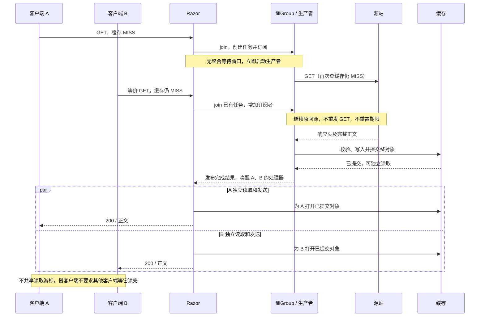
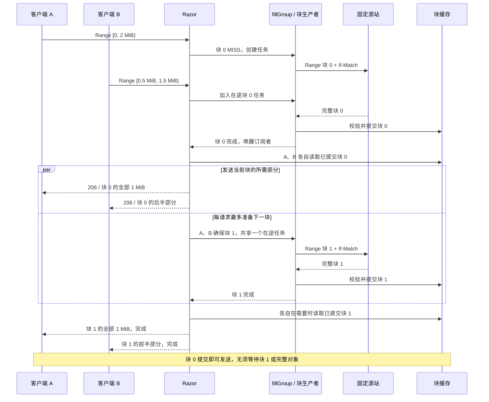

# 合并回源与原生部分对象缓存

本文介绍当前集成实现：HTTP 缓存键 v3 统一 query 顺序；其余缓存交付行为以已验收源码 `c93f4d7` 为基线。RWW 的发送时序见 [块级 RWW](RWW_IMPLEMENTATION.md)，持久化边界见 [磁盘格式与恢复](CACHE_STORAGE_FORMAT.md)。

## 两种能力如何配合

**合并回源**让等价并发请求共享一次填充任务；**部分对象缓存**把同一表示拆成可独立提交和淘汰的块。两者组合后，重叠下载共享缺块生产者，读者各自按偏移读取已提交块。

| HTTP 路径 | 共享单位 | 何时开始发送 |
| --- | --- | --- |
| 普通完整对象 | 整对象填充任务 | 整对象完整提交后 |
| 合格单 Range | manifest 探测、每个缺块任务 | 首个所需块完整校验并提交后 |
| 公共静态模式的合格大 GET | 与 Range 相同的 manifest、块 | 首块提交后；最终返回 200 |

完整 fresh 整对象 HIT 优先。公共模式的大 GET 路径要求对象大于 `max(1 MiB, range_block_bytes)`；小对象仍走整对象路径。冷 GET 可能先做一次共享 HEAD 探测，因此小文件也可能有 HEAD 成本。单 Range 块缓存不要求开启公共模式，但默认保守身份会限制跨客户端任务合并。

## 合并回源：先协调任务，再建立缓存写者

[`fillGroup`](../server/fill_group.go) 在发起回源前，用互斥锁原子执行 `join`：

1. 已有相同任务且 token 仍有效，就增加订阅者，不创建另一个生产者。
2. 没有任务且额度足够，则创建带独立总期限的生产者；启动后再次检查缓存，避免查找与创建任务之间的重复填充。
3. 生产者获取写者与回源额度，执行下载、校验、提交，再发布结果并唤醒订阅者。
4. 整对象订阅者通过 `OpenReadCommitted` 各自打开结果，不共享读取游标，也不直接读生产者的临时缓冲。

任务协调与存储所有权是两层机制：`fillGroup` 合并等价请求，缓存层 `OpenDir` 保证同一缓存对象的活动写入所有权。二者不能互相替代；没有 Writer 时，也需要协调尚在等待源站响应头的请求。

### 整对象合并时序

下图展示可缓存、身份等价的成功路径。`Razor` 代表各请求独立的处理器；`fillGroup / 生产者` 合并展示任务协调和独立下载协程。图中省略资源排队及失败分支。



**先来的请求不等后来的请求。** 合并没有固定时间间隔；窗口自然覆盖同一有效任务的在途时间。任务提交完成后的请求通常直接命中缓存。假设 A 在 0 ms 创建任务，B 在 20 ms 加入，100 ms 时完成提交，则两者等待约 100 ms、80 ms，而不是为 B 额外延迟 A。这只是时间线示例，不是实测延迟。

`shared_fill_timeout` 默认 **300 秒**，从任务创建时计算，后加入不会续期。它是生产任务总期限，不是攒请求的窗口，也不是每位订阅者重新获得 300 秒；资源排队、回源及写入超时可能更早失败。每个订阅者可独立取消；最后一个订阅者离开才取消共享生产者。

### 什么请求可以合并

缓存身份与在途任务身份不同：

| 身份 | 组成与作用 |
| --- | --- |
| URL 根键 | 配置命名空间、有效 scheme、Host、原始转义路径和按原始参数项排序的 query；使用 HTTP 键 v3 |
| 整对象表示键 | 根键及受支持的 Vary 字段和值 |
| 在途任务键 | 填充对象键、方法、Host、peer IP、请求头、TLS 状态及 runtime version 的哈希 |
| 失效凭证 | 回源前捕获的 `FillToken`；不靠任务键本身表达 PURGE 代次 |

默认保守模式中，不同 peer IP、UA 或其他请求头通常不能合并在途任务。命中已有缓存则仍按 HTTP 表示与新鲜度判断，任务键不是永久缓存键。

显式开启 `shared_fill_public_static=1` 后，表示该实例相应缓存资源不随客户端身份生成差异内容。[规范化模块](../proxy/public_request.go)在生成任务身份和实际回源请求时使用同一规则：

- 移除客户端 IP/转发身份和追踪头：`Forwarded`、`X-Forwarded-For`、`X-Real-IP`、`Traceparent`、`Tracestate`、`Baggage`、`X-Request-Id`、`X-Correlation-Id`。
- `User-Agent` 固定为 `Razor`，保留有效的转发 scheme/Host；proxy rewrite 不再重新注入首客户端 IP。
- `Accept-Encoding`、`Accept-Language` 保留原值；其他未知请求头仍保守参与任务身份与回源。支持的响应 Vary 仅为上述两个字段及其组合。
- Authorization、Cookie、有正文请求等不进入该公共共享路径；旁路保持普通代理语义。追踪关联仅在本地记录允许字段的哈希。

因此，不同 IP/UA/追踪头的等价公共请求可以共享；不同源站命名空间、query 参数内容、变体或 runtime version 不会被强行合并。对声明可缓存的响应，源站仍须正确提供 Vary；此开关不能替代源站的表示契约。

### Query 顺序无关契约

源站已保证参数项顺序不影响响应及鉴权语义。`GetCacheKey` 将原始 query 按 `&` 分隔，按完整原始项字典序排序，再生成 URL 根键。`a=1&b=2` 与 `b=2&a=1` 使用同一身份；重复项也按项排序，但数量保留。

不执行 URL 解码/重编码，不丢弃空项或异常字段，不删除参数。`flag` 与 `flag=`、`q=a+b` 与 `q=a%20b`、编码大小写、不同重复数量、有/无空 query 仍区分。源站收到首个生产者的原始 query 字节，无须改写回源 URL。

整对象、manifest/块、在途任务及精确 PURGE 都从该根键派生，因此换序请求共用缓存和任务，任一种顺序的 PURGE 都能失效同一 URL 家族，不影响其他参数值。公共模式仅额外规范化客户端相关头；query 顺序契约适用于默认模式和公共模式。

键前缀从 `http-v2` 升级为 `http-v3`，旧键安全 MISS，避免混用旧身份语义；不迁移、不删除既有缓存文件。此契约不适用于按原始 query 顺序区分内容或验签的源站。

### 取消、私有响应与限额

生产者不绑定首客户端的 Context，也不持有客户端 ResponseWriter。每个订阅者独立取消；首订阅者离开不影响其他人，最后一人离开才取消任务。独立 runtime 租约保证重载时旧 proxy/额度存活到任务结束。

普通整对象回源后若发现 `private`、`no-store`、Set-Cookie、不支持的 Vary 等不可共享语义，响应正文仅交给仍在等待的创建者；其他等待者受控失败，不立即各自回源。创建者已离开时，也不会把私有正文转交别人。块响应的校验/准入失败则不能发布为共享块。

任务、每任务订阅者、回源请求/连接、缓存写者及排队都有上限。额度不足会受控拒绝，不承诺无限等待或回源重试。

## 部分对象缓存：manifest 加独立块

### 元数据和键

[`rangeManifest`](../server/range_cache.go) 保存布局版本（当前 v2）、块大小、总长度、强 ETag、完整源站身份、变体和随机 `Incarnation`。manifest 是一个缓存对象，**它存在并不代表任意块存在**；没有覆盖整文件的常驻位图，每块独立查找、校验与淘汰。

块身份可概括为：

```text
根键 = 配置命名空间 + 有效 URL
manifest 键 = 根键 + 布局版本 + 块大小 + hash(完整源站身份, 变体)
block 键 = 根键 + hash(源站, 变体, 强 ETag, Incarnation, 布局, 块大小) + 块号
```

源站身份包括 scheme、authority、base path 和固定 query。同 ETag 的不同源站也不混块。manifest 刷新时，若强 ETag 和总长未变，可沿用 Incarnation；manifest 丢失后重建会使用新标识。块大小改变进入不同布局键，不错误解释旧偏移，也不删除或迁移已有文件。

### 缺块如何获取

1. 先找当前配置内 fresh manifest。缺失或过期时，以共享 HEAD 探测强 ETag、总长、identity 编码与缓存准入，提交 manifest。
2. 将请求区间映射到固定块号：`first = start / B`，`last = end / B`。首尾向块边界扩展，尾块以总长截断。
3. fresh 且校验通过的块直接复用；其余通过同一个 `fillGroup` 共享生产任务。任务身份去掉客户端 Range/If-Range，改由目标块键区分，等价的重叠区间可加入同一缺块任务。
4. 在访问源站前取得该 manifest/块的缓存写入所有权。未知头导致不同任务身份时，不绕过所有权再发起同块回源；竞争可能受控失败，而不是无条件合并或重复生产。
5. 固定本次响应的源站，对齐发送 `Range`、`If-Match: <强 ETag>`、`Accept-Encoding: identity`。
6. 严格校验 206、唯一且精确的 Content-Range、强 ETag、Content-Length、编码、实际 EOF 和无 Trailer。完整缓存一个块，发现截断或额外字节都不发布。
7. 写入前检查版本和原始失效凭证；通过完整对象提交路径提交该块，再由读者独立读取已提交数据。

完整 GET 与 Range 共享块要求相同源站、版本、布局和变体，并且请求经规范化后的其他头等价。原始 `Accept-Encoding` 缺省与显式 `identity` 仍是不同变体身份。

### 缺块合并与 RWW 时序

与整对象路径不同，块路径的共享单位是 **manifest 或一个缺块**。下例假设 fresh manifest 已存在，块大小 1 MiB，A 请求 `[0, 2 MiB)`，B 请求 `[0.5 MiB, 1.5 MiB)`；两者均需块 0、1，且其他任务身份等价。区间使用左闭右开记法。



图示假设下一块预取获得额度；不足时可放弃预取，发送当前块后再按需获取。若后一个请求到达时块已提交，则直接读取有效缓存，不必加入任务；两客户端的发送先后不作保证。manifest 缺失时，先共享 HEAD 探测并提交 manifest，再执行图中的逐块流程。

300 秒总期限按每个 manifest/块任务分别计算，不是整次大文件下载统一倒计时。首块发送前须完整校验并提交；不会把同一块的未提交字节广播给客户端。更完整的管线、背压和错误边界见 [RWW 实现](RWW_IMPLEMENTATION.md#管线时序)。

### 重叠区间示例

对一个 100 MiB 对象使用 1 MiB 块，先读 `[0,16 MiB)`，再读 `[8,24 MiB)`：

| 请求 | 复用块 | 新增块 | 正文回源累计 |
| --- | --- | --- | --- |
| 第一次 | 无 | 0–15，共 16 MiB | 16 MiB |
| 第二次 | 8–15，共 8 MiB | 16–23，共 8 MiB | 24 MiB |

对应 HTTP Range 为 `bytes=0-16777215` 与 `bytes=8388608-25165823`。在同版本、fresh、未淘汰条件下只回源区间的对齐并集；HEAD 请求另计。非对齐请求会读取所在整块，因此可能有边界字节放大；只发送客户端所需的切片，不后台补完整文件。

## RWW、失效与离线读取

发送时采用“提交当前块、发送当前块、最多准备下一块”的管线，详见 [RWW 实现](RWW_IMPLEMENTATION.md)。块缓存是服务端原生路径，直接复用缓存提交、校验、RAM、磁盘和失效接口，不需要插件回环请求，也不是把每个任意 Range 响应原样存一份。

- **PURGE**：回源前捕获根 URL 的 `FillToken`，manifest/块通过 `DeriveFill` 继承该凭证；旧任务不能重新捕获新代次发布。精确 PURGE 同时移除普通表示及其 Range 家族，已提交的相邻 URL 保留。当前 PURGE 还会保守使其他在途操作失效。
- **版本变化**：每块开始发送前检查 token 和可观察到的 manifest 版本。已知 ETag/总长变化停止旧流；manifest 被淘汰仅代表未知，不直接判为内容变化，补块仍由固定强 ETag 约束。
- **换源与重载**：新配置使用相应命名空间，新在途任务按 runtime version 隔离；旧任务持有旧 runtime 完成，不把多个源站的块拼进同一响应。普通整对象路径仍假设配置池内副本可互换。
- **离线**：先按稳定配置顺序查缓存，优先健康候选；单个仍在配置中的源站，其 manifest 和整个所需区间的块都 fresh 且完整时，即使全源站不健康也可零回源读取。缺块、过期、损坏或发送中被淘汰时不能保证离线成功；这不是 stale-if-error，也不会重新启用已从配置删除的源站。
- **重启**：manifest 和块共用检查点恢复。干净关闭后恢复完整且校验通过的对象；异常退出允许安全冷 MISS，不承诺每块 fsync 或断电零丢失。

## 配置与观察

示例片段写入配置目录的 `records.config`；公共模式仅用于符合前述源站契约的资源：

```text
CONFIG proxy.config.cache.shared_fill_public_static INT 1
CONFIG proxy.config.cache.range_block_bytes INT 1048576
CONFIG proxy.config.cache.max_object_bytes INT 268435456
CONFIG proxy.config.cache.shared_fill_max_tasks INT 16
CONFIG proxy.config.cache.shared_fill_max_waiters INT 256
CONFIG proxy.config.cache.shared_fill_timeout INT 300
```

这些任务额度和期限是默认值；`max_object_bytes` 此处特意从默认 64 MiB 调到 256 MiB，以允许 100/200 MiB 对象。块大小默认 1 MiB，允许 64 KiB–8 MiB 的 2 次幂。公共模式、块大小变更须重启；具体字段见 [配置实现](../config/coalescing.go) 与 [资源校验](../config/limits.go)。

[`Stats`](../server/stats.go) 提供 `SharedFillTasks/Waiters/Joined`、`RangeBlockHits/Misses`、`RangeHitBytes/MissBytes`、`Origin.Requests/Bytes`、`CacheWriters`、`RangeReaders` 与 `BufferReserved`。请求命中、块命中和实际回源正文是不同口径：部分命中的请求仍可能记为 MISS，HEAD 不能计作正文 GET。

## 代码与回归入口

| 关注点 | 实现 | 已有回归 |
| --- | --- | --- |
| 任务协调、取消、私有响应 | [fill_group.go](../server/fill_group.go)、[shared_fill.go](../server/shared_fill.go) | [coalescing_test.go](../server/coalescing_test.go) |
| 跨客户端身份规范化 | [public_request.go](../proxy/public_request.go) | [public_static_test.go](../server/public_static_test.go) |
| manifest、缺块、GET/Range 共用 | [range_cache.go](../server/range_cache.go) | [rww_test.go](../server/rww_test.go)、[range_test.go](../server/range_test.go) |
| 版本、失效与旧任务隔离 | [invalidation.go](../cache/invalidation.go)、[runtime.go](../server/runtime.go) | [range_version_fence_test.go](../server/range_version_fence_test.go)、[derived_test.go](../cache/derived_test.go) |
| 离线区间与配置边界 | [range_cache.go](../server/range_cache.go) | [range_offline_test.go](../server/range_offline_test.go) |

现阶段不支持多 Range 块缓存、任意区间树、未提交字节级 HTTP RWW、跨节点合并或分布式失效。实际测量及容量边界以 [CDN 验收报告](benchmarks/CDN_ACCEPTANCE_2026-10-21.md) 为准，不把功能机制当作性能领先证据。
