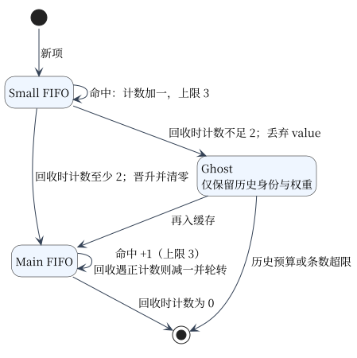

# RAM 缓存与发送缓冲

RAM 是磁盘之上的可淘汰加速层；默认 Otter v2.2.1（adaptive W-TinyLFU），可选 S3-FIFO。每 stripe 默认 10 MiB，0 禁用；策略/容量重启生效，不改变磁盘身份、格式或读盘 promotion。配置见 [功能契约](FEATURE_PLAN.md#配置)。

## 共同契约与预算

| 项目 | 语义 |
| --- | --- |
| API | Get/Put/Delete/Items/Size/CleanUp/Stats；只读 value，替换不修改旧读者字节；删除不被旧队列事件复活 |
| 安全 | 每次打开仍检查目录/CRC/版本/PURGE；淘汰 MISS 可回磁盘；超大替换先删除旧映射 |
| 权重 | Size/ChargedBytes = max(1, 序列化 value 长度) + 可解析 HTTP 元数据的保守估算 |
| 元数据 | 与条目一起替换/淘汰；每读者深复制 Header；额外权重会减少驻留条目数 |
| 边界 | key ≤64 KiB；单项权重须适合 uint32 且不超过容量，否则跳过 RAM |
| Otter | 异步维护允许短时超权重，CleanUp 后检查收敛；不保证同步硬上限 |
| S3-FIFO | Put 返回前收敛；resident ≤min(容量字节数, 65,536) 条 |
| Ghost | 无 value；条数同上，历史权重 ≤容量；key/node 估算 ≤max(128, 容量/10) 字节 |

预算不等于 RSS：key/node/map/allocator/runtime 另占内存，读者可持有已淘汰 value。S3 resident 最坏 key/node 估算可近 `65536 × (128 + 65536)` B；Otter 空项最小权重只约束稳态条数，不限制总进程内存。历史 Otter 超 10 MiB 采样及异步快照边界见 [验收报告](benchmarks/CDN_ACCEPTANCE_2026-10-21.md)。

## S3-FIFO 状态



计数初值 0、上限 3；更新计一次引用且不改变队列位置，命中不重排。单 mutex，无异步发布队列。Main 超过容量 90% 或 Small 为空时回收 Main，否则回收 Small；不能理解为 cold-start Small 永远仅占 10%。Delete 同时清除 resident 与 ghost。

参考 ATS 10.2.0 [固定实现](https://github.com/apache/trafficserver/blob/b1df7334b39a878971c376da849e8da4984918b6/src/iocore/cache/RamCacheS3FIFO.cc)，Apache-2.0；[归属](../THIRD_PARTY_NOTICES.md)。移植增加字节/条数边界与并发语义，没有复制无许可的论文 artifact。

## Stats

| 字段 | 口径 |
| --- | --- |
| ResidentBytes | 序列化 value 的 len 合计；含 Doc/HTTP/manifest，不是纯正文 |
| ChargedBytes / DecodedMetadataBytes | 策略权重 / 已计入权重的解码估算 |
| EstimatedMetadataBytes | node/key 估算 128 + key bytes，再加解码估算；不含 map 空桶、allocator、sketch/buffer/runtime |
| GhostBytes | 被记住的旧 value 权重，非实际保存的正文 |
| 其他 | Algorithm/CapacityBytes、Resident/Ghost/Small/MainEntries、Hits/Misses/Evictions/EvictionWeight、Promotions/GhostHits |

按 stripe 弱一致采样，不宜每请求调用；不可拼接不同时刻字段当作精确同步峰值。

## HTTP 发送缓冲

| 字段 | 当前及未排空旧 runtime 的合计 |
| --- | --- |
| ResponseBufferCapacityBytes | 每 runtime 活动 payload 容量 = max_requests × 256 KiB；默认 64 MiB，按需分配 |
| ResponseBufferInUseBytes | 当前活动租约字节 |
| ResponseBufferTotalAllocatedBytes | 各 runtime 创建以来累计新分配；GC 清池后可超过容量，移除旧 runtime 后可下降 |

额度等待可取消，结束归还；空闲 sync.Pool 由 GC 管理，无硬空闲/RSS 上限。此预算独立于 CacheWriteBufferBytes/BufferReserved。实测及大文件代价见 [热路径报告](benchmarks/HTTP_HOTPATH_2026-10-23.md)。

## 验证

```bash
go test ./cache ./config ./server -count=1
go test -race ./cache -run 'TestRAM|TestS3FIFO' -count=1
go test ./cache -run '^$' -bench '^BenchmarkRAMTrace$' -benchmem -benchtime=2s -count=3
```

10 MiB、256 B/256 KiB/1 MiB/4 MiB、0.5/1/4 倍工作集，覆盖扫描/热点切换/混合读写。逻辑 MB/s 不复制全部正文，不能当 HTTP 或磁盘吞吐。报告：[开发机轨迹](benchmarks/RAM_POLICY_2026-10-21.md)、[专机/两策略各两小时](benchmarks/CDN_ACCEPTANCE_2026-10-21.md)。
