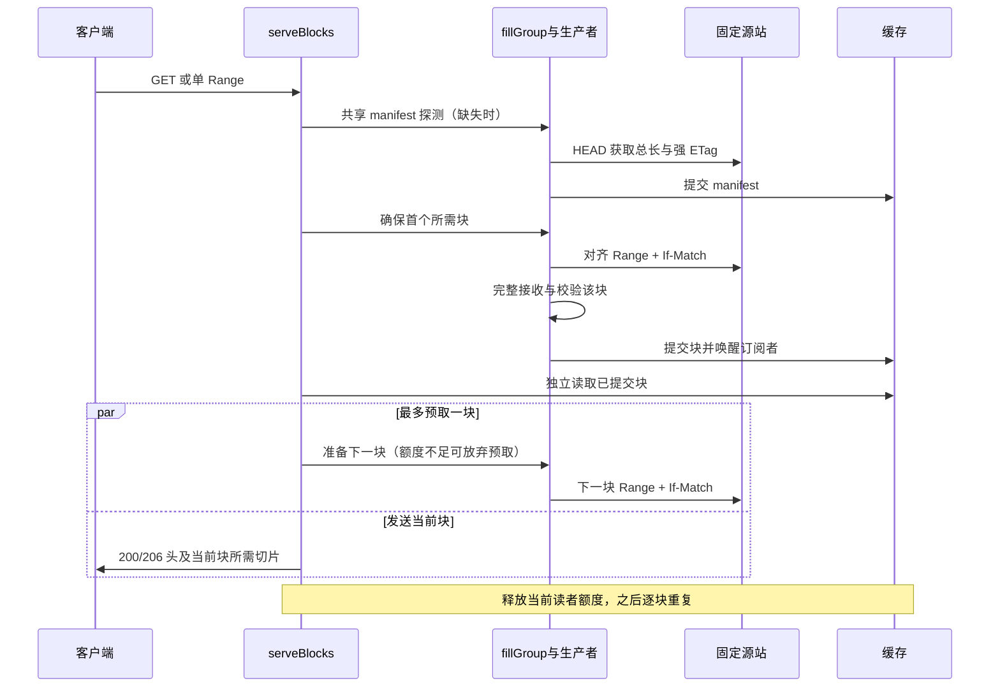

# Razor 块级 RWW 实现

RWW（Read While Write）在当前 HTTP 服务中表示：**完整对象尚未填完时，已完整校验并提交的块就可发送，后续块继续填充。** 不读取当前块的未提交字节。请求共享和块身份见 [合并回源与部分对象缓存](CACHE_FILL_DESIGN.md)。本文对照源码基线 `c93f4d7`。

## 适用路径

| 路径 | 当前行为 |
| --- | --- |
| 普通整对象 MISS | 等待整对象完整提交，再由各订阅者读取 |
| 合格单 Range | 首个所需块提交后发送，返回 206 |
| 公共静态模式的合格大 GET | 与 Range 共用块，首块提交后发送，返回 200 |
| 不可缓存/不支持的请求 | 普通代理旁路；流式透传不等于缓存 RWW |

大 GET 要求开启 `shared_fill_public_static`，对象长度大于 `max(1 MiB, 块大小)`，且满足块缓存的强 ETag、HEAD、identity 编码和准入条件。fresh 整对象命中和小对象继续保留原路径。

## 管线时序

两个重叠 Range 如何加入同一缺块任务，见[缺块合并与 RWW 时序](CACHE_FILL_DESIGN.md#缺块合并与-rww-时序)；下面聚焦单个请求的逐块发送管线。



控制循环是 [`serveBlocks`](../server/range_cache.go)：`ensureRangeManifest` → `ensureRangeBlock` → `readPreparedRangeBlock` → `checkRangeVersion` → `streamResponse`。发送当前块时最多启动一个下一块任务，且不超出本次请求区间。相同块的等价请求共享生产者，每个客户端保持独立位置、数据切片和发送速度。

阻塞第二块时，客户端仍应收到完整首块。这由 `TestRangeCommittedBlockArrivesBeforeSecondBlock` 与 `TestPublicGETCommittedBlockArrivesBeforeSecondBlock` 的同步屏障和真实 HTTP 读取断言验证，不是只检查返回 200/206。

## “校验并提交”包含什么

1. 回源必须精确返回所需 206 区间、总长度、强 ETag、identity 编码和 Content-Length，无不支持的缓存语义/Trailer。
2. `readExactRange` 完整接收块正文，并额外读一次确认 EOF；短读、超长或读错误不发布。
3. `writeRangeObject` 复用 `CacheVC`/`cacheFill` 完整对象写入，存储 Doc 带 CRC32。一个逻辑 HTTP 块可能包含多个底层 fragment；可配置块大小不改变底层 fragment 的定义。
4. [`CacheWriter.Close`](../cache/cache_write.go) 最后写 fragment 0，等待相应写入完成并校验目录/覆盖代次、对象所有权和失效凭证后发布完整对象。HTTP 读者使用 `OpenReadCommitted`，再次按存储校验读取。

提交意味着该块已完成存储写入与可读性发布，**不等于每块调用 fsync**。当前磁盘数据路径使用 `ReadAt/WriteAt` 和聚合缓冲；不是 io_uring/native AIO，也不是读者直接订阅 Writer 缓冲的零拷贝广播。异常退出恢复策略见 [存储文档](CACHE_STORAGE_FORMAT.md)。

## 有界内存与背压

HTTP 不缓存整份大响应到内存。生产者暂存一个完整块，读者在额度下读取当前已提交块；下一块预取使用 `TryAcquire`，额度不足时可退回按需准备。当前块发送完成后释放读者额度，避免拿着当前数据无限等待更多预取额度。

写者槽数为 `min(max_writers, write_buffer_bytes / CacheWriterReservation())`，读者另有按槽限额。预留包含生产者暂存块、发送读者、fragment 与元数据开销；不是“两个块大小就是整个进程内存上限”。磁盘容量按必要块窗口检查，无须先容纳整对象，但不能小于所需窗口。

块准备完成不代表目录被永久固定。并发环形写入可能逐出尚未发送的块；`readPreparedRangeBlock` 对缺失/写入中的块先检查原 token 和版本，再按固定源站/ETag重新补块。已有独立校验字节可完成当前发送；后续读失败仍必须中断。

## 协议与失败边界

- 发送前裁剪首尾块，设置正确的 Content-Length/Content-Range。完整 GET 为 200，单 Range 为 206；If-Range 不匹配时按完整表示旁路，非法区间可返回 416。
- 合成的 200/206 目前向下游发送 `Cache-Control: no-cache`，因为还未汇总所有块的有效期；内部仍按 manifest 与各块 freshness 决定复用。
- 响应头发送前，失败可按具体错误返回 5xx 或安全旁路；并非所有失败都可降级，写入所有权冲突不会通过旁路重复生产。
- 响应头发送后，后续源站/读取失败、已观察到的版本变化或 PURGE 失效会通过 `http.ErrAbortHandler` 中断 HTTP 响应/H2 流。不能在文件尾追加错误正文，不能换源或换版本继续拼接。
- 每块开始发送前检查失效；已经发出及网络缓冲内的字节无法撤回。客户端取消会取消本请求预取订阅并等待其退出；其他仍订阅同一块的客户端可继续。

## 配置和回归

`proxy.config.cache.range_block_bytes` 默认 `1048576`（1 MiB），允许 64 KiB–8 MiB 的 2 次幂，修改须重启。较小块降低冷读首块等待和非对齐放大，但增加元数据/回源请求；较大块相反，需用实际负载测量。

[RWW 回归](../server/rww_test.go)覆盖首块提前到达、GET/Range 共用、重叠区间回源并集、可配置块与非对齐尾块、100 MiB 最小预算窗口、后续失败与取消。[淘汰回归](../server/rww_eviction_test.go)覆盖准备后被淘汰和多客户端环形窗口；[版本回归](../server/range_version_fence_test.go)覆盖已知替换中止及同强 ETag/总长刷新继续。

运行相关行为回归（在仓库根目录）：

```bash
go test ./server -run 'Test(RangeCommittedBlockArrivesBeforeSecondBlock|PublicGETCommittedBlockArrivesBeforeSecondBlock|PublicGETAndOverlappingRangeShareBlockProducers|RangeOnlyFetchesMissingAlignedUnion|CommittedBlockStreamAbortsOnLaterOriginFailure)$' -count=1 -timeout 120s
```

缓存底层仍保留 `NewCacheReaderFromWriter` / `CacheWriter.ReadAtContext` 等活跃 Writer 读取接口；它们不是当前 HTTP 交付路径，不能据此声称 HTTP 已支持未提交字节级 RWW。[简表](RWW_SUMMARY.md)与 [ATS 对比](RWW_ATS_COMPARISON.md)使用同一行为边界。
