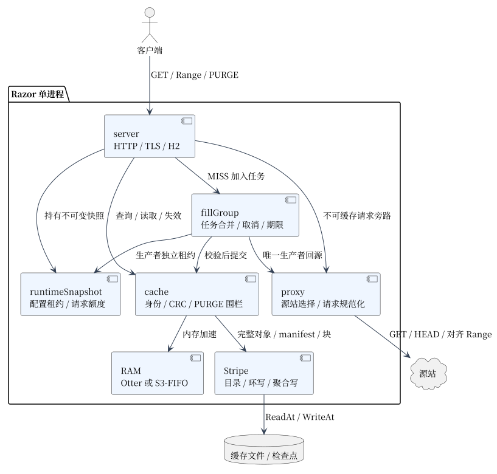

# Razor 架构

当前分支的 Go HTTP 缓存代理。主路径由 `server`、`proxy`、`cache` 组成；任务协调与存储写入所有权分离。



| 模块 | 职责 | 代码 |
| --- | --- | --- |
| HTTP / runtime | 协议、不可变配置租约、请求额度、排空 | [server](../server/runtime.go) |
| fillGroup | 回源前合并任务、独立生产者、订阅取消和期限 | [协调器](../server/fill_group.go) |
| proxy | 固定源站、公共身份规范化、回源连接与超时 | [proxy](../proxy/proxy.go) |
| cache / Stripe | 提交、CRC、目录、覆盖代次、PURGE、恢复 | [cache](../cache/cache.go) |
| RAM | 磁盘之上的可淘汰加速层 | [RamCache](../cache/ram_cache.go) |

| 请求路径 | 共享单位 | 首次可发送时机 |
| --- | --- | --- |
| fresh 整对象 HIT | 已提交表示 | 校验读取后 |
| 普通整对象 MISS | 整对象任务 | 完整提交后 |
| 单 Range / 合格公共大 GET | manifest、每个缺块 | 首个所需块完整提交后 |
| 不可缓存请求 | 普通代理 | 按代理语义透传 |

## 生命周期与边界

| 事项 | 契约 |
| --- | --- |
| 配置重载 | 原子安装；失败保留现配置；最多一个未排空旧 runtime；请求/生产者各持租约 |
| 需重启项 | 存储、监听/证书、公共模式、块大小、RAM 策略等，见 [配置校验](../server/runtime.go) |
| 失效 | 回源前捕获 FillToken，派生块继承；旧任务不能取得新代次后复活 |
| 源站 | 块响应固定完整源站身份；普通整对象池假定副本可互换 |
| 内存 | 请求、生产者、读写者和缓冲分别限额；不是统一 RSS 硬上限 |
| I/O | 普通 ReadAt/WriteAt 与聚合写；无 io_uring/native AIO；提交不等于 fsync |

缓存层的对象模型、磁盘布局和读写路径见 [缓存设计](cache_design.md)。

设计入口：[合并与块缓存](cache_fill_design.md) · [RWW](rww_implementation.md) · [RAM](ram_cache.md) · [存储恢复](cache_storage_format.md)。

[PlantUML 图源与 SVG](diagrams/)同目录保存（渲染工具 1.2026.9）；修改图源后重新生成。仅在本机渲染，不依赖在线 UML 服务：

```bash
java -jar "$PLANTUML_JAR" -charset UTF-8 -tsvg -nometadata -failfast2 docs/diagrams/*.puml
```

文档文件名使用小写下划线；报告日期采用 YYYY-MM-DD，图源与图片同名。根目录 README.md、LICENSE 等保留通用命名。
