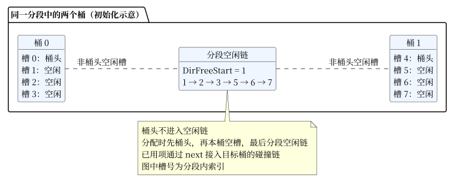
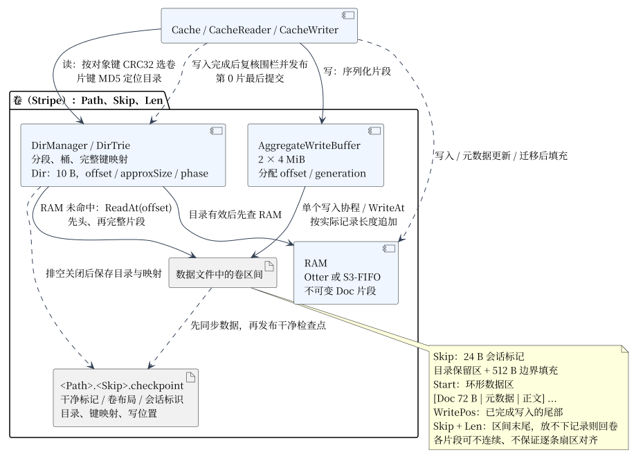
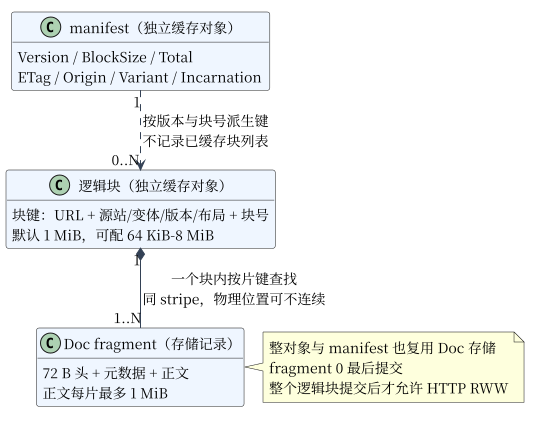
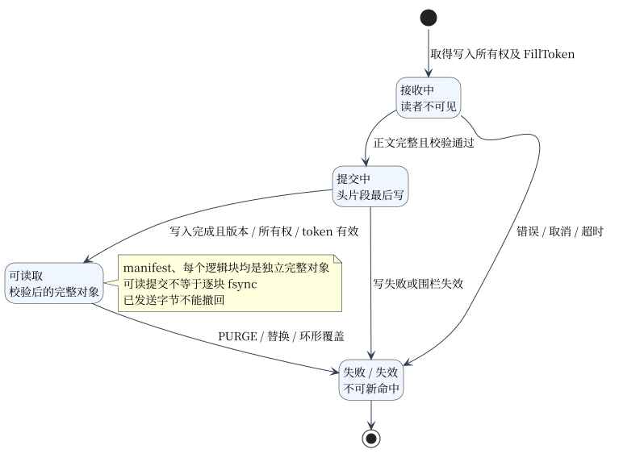

# 缓存设计

缓存按键保存 HTTP 表示，使用紧凑内存目录定位磁盘记录，以环形日志复用磁盘空间，并用 RAM 加速读取。整对象、清单和每个逻辑块都是独立缓存对象，共用分片、校验与提交机制。

## 数据结构

- **Doc**：磁盘记录，保存一个存储片段的头、元数据和正文。
- **Dir**：常驻内存的紧凑目录项，指向一个 Doc。
- **Stripe**：卷，管理数据文件中的固定区间、目录、写指针和恢复状态。
- **RAM**：保存不可变片段的内存加速层，可独立淘汰。

### 数据记录（Doc）

正文按固定上限拆成片段（fragment），每片最多 **1 MiB**。每条记录由 **72 B 的 Doc v3 头 + 元数据 + 正文** 组成，头字段按大端序序列化。

| 字段 | 类型 | 字节 | 含义 |
| --- | --- | ---: | --- |
| Magic | uint32 | 4 | 固定 `0x5F129B13` |
| Len | uint32 | 4 | 本片头、元数据和正文的实际总长 |
| TotalLen | uint64 | 8 | 片 0 为对象总长；后续片为该片正文的逻辑结束偏移 |
| FirstKey | [16]byte | 16 | 对象键 SHA-256 的前 16 B |
| Key | [16]byte | 16 | 当前片键 SHA-256 的前 16 B |
| HLen | uint32 | 4 | 元数据长度；HTTP 元数据只在片 0 |
| DocType / VMajor / VMinor / Unused | 各 uint8 | 4 | 写入值为 `0 / 3 / 0 / 0` |
| SyncSerial / WriteSerial | 各 uint32 | 8 | 组合成随机写者版本，标识同一次对象写入 |
| Pinned | uint32 | 4 | 写入值为 0，不提供固定驻留保证 |
| Checksum | uint32 | 4 | IEEE CRC32，覆盖校验字段置零的头、元数据和正文 |

片 0 保存总长与 HTTP 元数据，是对象的读取入口；其他片段按片号派生键，并校验写者版本和长度，避免替换过程中混读。代码见 [Doc](../cache/doc.go)、[片段键](../cache/cache.go)。

### 目录项（Dir）

Dir 使用 `[5]uint16` 保存 **10 B** 字段，通过位操作读写。

| 字段 | 位数 | 含义 |
| --- | ---: | --- |
| offset / offset_high | 24 + 16 | 合成 40 bit 文件字节偏移 |
| bigInternal / sizeInternal | 2 + 6 | 近似长度的级别与计数 |
| tag | 12 | 键哈希的候选标签 |
| phase | 1 | 环形写入的阶段标志 |
| head / pinned / token | 各 1 | 标志位；token 位与 HTTP 填充的 FillToken 是不同状态 |
| next | 16 | 同一分段内的下一目录项 |

空闲项复用 `raw[2]` 保存空闲链的前驱。近似长度为 `512 × 8^bigInternal × (sizeInternal+1)`，最多 **16 MiB**；实际记录长度取 Doc.Len。目录外另存每项 16 B 身份摘要，并在读取 Doc 时核对键摘要。

目录按卷长度约每 8 KiB 一个槽规划，再按桶和分段取整；完整键映射、身份数组、RAM、缓冲和运行时另占内存，不能只用“对象数 × 10 B”估算总开销。代码见 [Dir](../cache/dir.go)、[DirManager](../cache/dir_manager.go)。

### 分段、桶与空闲链

Dir 保存在连续数组中，分段（segment）包含桶（bucket），每桶固定 **4 个槽**，每分段最多 **65,536 个槽**。同一桶的碰撞项通过 next 串联；桶头以外的空闲槽进入分段空闲链，由 `DirFreeStart` 记录入口。

MD5 将片段键映射到分段、桶和 tag。分配先找桶头、再找本桶空槽，最后取分段空闲链；没有可用项时重建空闲链，必要时回收部分桶。新项从空闲链移除，再接入目标桶的碰撞链。

### 卷（Stripe）

`CRC32(对象键) % 卷数量` 选择卷。同一对象的所有存储片段位于该卷；不同对象或逻辑块可分布到不同卷。一个数据文件可以切成多个互不重叠的卷区间，卷不跨文件边界。

| 位置 / 字段 | 含义 |
| --- | --- |
| Path / Skip / Len | 数据路径、卷起点和卷长度 |
| Skip 起的 24 B | 会话标记，保存 magic、版本和随机 session |
| Start | `Skip + align512(24 + 目录保留区大小)`，环形数据区起点 |
| WritePos | 已完成写入的尾部 |
| Skip + Len | 卷末尾；剩余空间放不下完整记录时回卷 |
| `<Path>.<Skip>.checkpoint` | 独立检查点文件，保存目录、键映射和写位置 |

聚合写按记录实际字节推进，数据区起点按 512 B 对齐，**每条 Doc 的起点不保证扇区对齐**。记录可交错追加，同一对象的片段在磁盘上也可不连续。

### RAM 缓存

每卷默认使用 **10 MiB 权重预算**，默认策略为 Otter，可选 S3-FIFO；容量设为 0 可禁用。RAM 保存不可变序列化片段及可复用的解码元数据，每次读取仍检查目录有效性与 Doc 校验。

写入、元数据更新和热片段迁移会填充 RAM；普通读盘不会自动晋升到 RAM。RAM 淘汰后，目录仍有效即可回磁盘读取。权重预算不等于进程 RSS，策略与统计见 [RAM 缓存](ram_cache.md)。

### 清单与逻辑块

部分对象缓存使用清单（manifest）记录总长、强 ETag、完整源站身份、变体、随机 Incarnation、布局版本和块大小；每个逻辑块独立保存。清单不维护全文件常驻位图，存在清单不代表块已齐全。

| 身份 | 组成 |
| --- | --- |
| URL 根键 | 配置命名空间、有效 scheme/Host、原始转义路径、排序后的原始 query 项 |
| 整对象表示键 | URL 根键、受支持的 Vary 字段和值 |
| 清单键 | URL 根键、完整源站身份、变体、布局版本和块大小 |
| 逻辑块键 | URL 根键、源站、变体、强 ETag、Incarnation、布局、块大小和块号 |
| 存储片键 | 片 0 用对象键，后续片用 `MD5(对象键 || uint64BE(片号))` |

逻辑块决定回源区间和 RWW 屏障，默认 **1 MiB**，可配 **64 KiB–8 MiB** 的 2 次幂；存储片段的正文上限固定为 1 MiB。例如 4 MiB 逻辑块拆成 4 个存储片段，整个逻辑块提交后才可发送。

缓存、任务和 PURGE 共用 URL 身份。query 按原始参数项排序，保留值、数量、空项与编码差异，回源不重排；源站须保证参数顺序无关。公共共享模式还要求内容不随客户端身份变化，完整规则见 [共享身份](cache_fill_design.md#共享身份)。

## 写入

等价并发 MISS 由 fillGroup 共享一个独立回源生产者，无人为聚合等待窗口；缓存层 OpenDir 单独管理写入所有权。

1. 回源前捕获 FillToken，取得目标对象的写入所有权；派生块继承父失效围栏。
2. 接收正文并拆片，暂存片 0；后续片段构造 Doc 与 CRC 后进入聚合缓冲。
3. 聚合缓冲分配文件偏移、覆盖代次和序号，磁盘写协程在该位置执行 WriteAt。
4. 等待对应写入完成，复核所有权、覆盖代次和失效围栏，再发布该片的目录与 RAM 映射。
5. 正文完整后写片 0；发布前确认此前片段仍有效，完成整个对象提交，再唤醒等待读者。

聚合缓冲为 **2 × 4 MiB**，每卷一个磁盘写协程。写者每片都等待对应写入完成，不保证每次都攒满 4 MiB。提交可读不等于逐块 fsync；失败写入不得作为完整对象命中。

写到卷尾后从数据区起点继续追加，phase 与覆盖代次识别失效位置；即将覆盖的已访问片段可通过有界热片段迁移（evacuation）保留。迁移会产生额外读写，队列满可放弃，见 [迁移流程](evacuation.md)。

## 读取

1. HTTP 层确定表示键，通过对象键选择卷，再用片段键查目录。
2. 检查目录偏移、phase 与正在覆盖的区间；有效后先查 RAM。
3. RAM MISS 时通过 ReadAt 先读 72 B Doc 头，再按 Doc.Len 读取完整片段；不共享 Seek 游标。
4. 校验 CRC、键摘要、写者版本与片段长度，HTTP 层另判断新鲜度、变体及失效凭证。
5. 依次加载后续片段，将所需正文复制给客户端；片内正文位于 `Dir.offset + 72 + HLen`。

| 请求路径 | 首次可发送时机 |
| --- | --- |
| 新鲜整对象命中 | 校验读取后 |
| 普通整对象 MISS | 整对象完整提交后，各客户端独立读取 |
| 合格单 Range / 公共大 GET | 首个所需逻辑块完整提交并校验后 |

同一对象后续片段也按键重新查目录，不能用“文件基址 + HTTP Range 偏移”定位。块读取先完整校验，再裁剪首尾；小 Range 也可能产生整块回源和读取放大。

### 范围请求与块级 RWW

请求区间用左闭右开 `[a,b)` 表示，块大小为 B，所需块号从 `floor(a/B)` 到 `floor((b-1)/B)`。第 i 块回源 `[iB, min((i+1)B, 总长))`，发送给源站时转换成 HTTP 闭区间 Range，并带 If-Match 与 identity 编码。

例如 B=1 MiB，清单新鲜有效，客户端请求 `[0.5,2.5 MiB)`；同版本的块 0、2 新鲜且读取前未被淘汰，块 1 缺失：

| 步骤 | 行为 |
| --- | --- |
| 1 | 读取清单，固定源站、版本和布局；一般路径中清单缺失或过期则共享 HEAD |
| 2 | 读取块 0，发送后半 MiB，同时可准备块 1 |
| 3 | 块 1 加入或创建共享任务，仅回源 `[1,2 MiB)`；校验 206、Content-Range、强 ETag、长度、EOF 和 Trailer 后提交 |
| 4 | 发送整个块 1，再发送块 2 前半 MiB，完成响应 |

每请求最多提前准备下一块，预算不足时按需读取，不在后台补齐整个对象。每块发送前检查原始失效凭证和可观察版本；头已发送后的换版、失效或后块错误必须中断响应。HTTP RWW 读取完整提交块，不读取活跃写者的未提交字节。时序见 [合并回源](cache_fill_design.md#缺块合并与-rww-时序)、[RWW](rww_implementation.md)。

## 元数据持久化

卷使用 **v2 会话标记、v3 Doc 和 v1 检查点**。检查点保存卷边界、写位置、phase、session、目录以及完整键/selector 映射，并用校验和保护。

| 阶段 | 操作 |
| --- | --- |
| 打开 | 独占底层 inode；只加载会话、布局和校验匹配的干净检查点，逐项验证全部片段；暴露访问前写入并同步新 session |
| 运行中保存 | 同步数据并发布 dirty 检查点；活动会话不能用它恢复命中 |
| 正常关闭 | 停止新工作、终止活跃写者并排空写入；sync 数据 → 写并 sync 临时 clean 检查点 → 原子替换 → sync 父目录 |
| 异常退出 / 损坏 | 安全冷 MISS，不扫描旧日志重建，也不删除或截断原文件 |

同一缓存 inode 不跨进程共享。关闭后恢复只接受验证完整的对象；提交不承诺逐块断电持久性。格式、限额与故障验证见 [存储与恢复](cache_storage_format.md)。

## 失效与运行边界

| 情况 | 行为 |
| --- | --- |
| PURGE | 配置令牌后启用，失效同 URL 的普通表示和块家族；派生块沿用原 FillToken，旧任务不能取得新代次后发布 |
| 块或清单淘汰 | 块可独立丢失；同版本清单刷新可沿用 Incarnation，丢失后重建则换标识 |
| 离线 | 同一仍配置源站的清单与所需块均新鲜、完整可读时零回源，不提供 stale-if-error |
| 资源预算 | 请求、任务、读者、写者与缓冲分别限额；不是统一进程内存硬上限 |
| 支持范围 | 单 Range 块缓存；不提供多 Range 块缓存、跨节点合并/失效、未提交字节级 HTTP RWW 或 io_uring/native AIO |

默认最多 16 个共享任务、每任务 256 个订阅者、总期限 300 秒；默认对象限制 64 MiB，处理 100/200 MiB 对象需调大。参数见 [配置](configuration.md)。回卷期间 no-store 更新后仍可能命中旧对象的问题由 [#33](https://github.com/Monsterwi/razor/issues/33) 跟踪。

## 来源

目录与环形写思路源于 [bocchi-the-cache/bakemono Tech Design @5279a99](https://github.com/bocchi-the-cache/bakemono/blob/5279a99634d0c8ca7298f8b63b645de518fbe190/README.md)，采用 [Apache-2.0](../LICENSE)。本文将说明译为中文，并按项目实现更新字段、布局和图示。

原始配图：[目录初始化](dirs_init.png)、[目录分配](dirs_used.png)、[卷结构](vol_struct.png)、[环形写入](data_write.png)。
