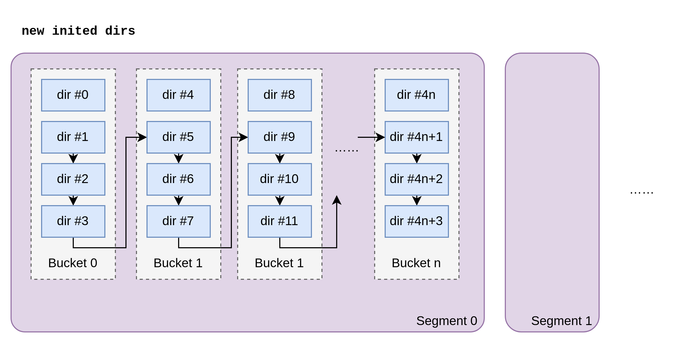
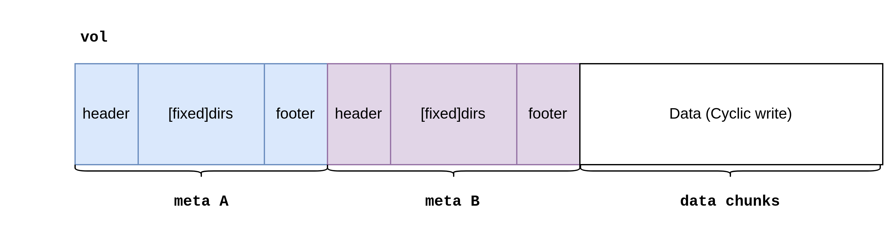
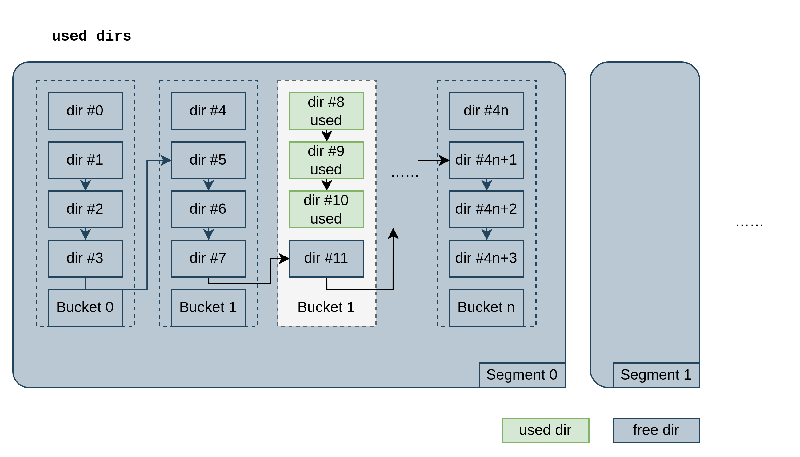
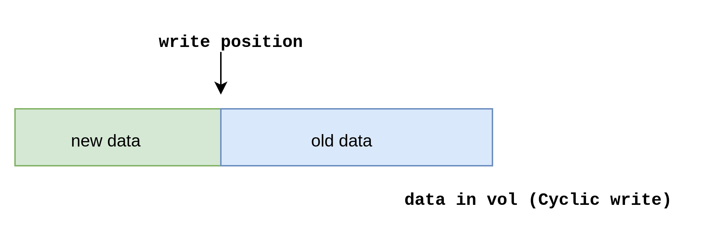

# Tech Design

来源：[bocchi-the-cache/bakemono README @5279a99](https://github.com/bocchi-the-cache/bakemono/blob/5279a99634d0c8ca7298f8b63b645de518fbe190/README.md)，[Apache-2.0](../LICENSE)。本页保留原 Tech Design 内容，仅调整标题层级、空白和图片路径。

> 这是原项目的 Vol/Chunk 设计参考，其中格式与规划不代表当前 Razor。当前架构与格式见 [architecture.md](architecture.md) 和 [cache_storage_format.md](cache_storage_format.md)。

... until now.

## Data Structure

There are 3 data structures in `bakemono`:

- **`Vol`**
  - **volume**, represents a single file on disk.
  - A `Vol` is what we finally persist on disk.
  - We will support bare block device in the future.
- **`Chunk`**
  - basic unit of your k-v cache data.
  - restored on disk.
- **`Dir`**
  - **directory**, a meta index of `Chunk`.
  - All `Dir`s are loaded in memory. It is compact.

### 🧱 Chunk
`Chunk` is the basic unit of cache data.

| name           | data type      | desc                  |
|----------------|----------------|-----------------------|
| Magic          | uint32         | fixed: 0x00114514     |
| Checksum       | uint32         | checksum of DataRaw   |
| Key            | [3000]byte     | fixed size key bytes  |
| DataLength     | uint32         |                       |
| HeaderSize     | uint32         | fixed: 4096.          |
| HeaderChecksum | uint32         | checksum of the above |
| DataRaw        | variable bytes | raw data              |

We force set chunk header size to 4KB this version, a sector size.

### 🔖 Dir
`Dir` is the meta index of `Chunk`.

Every `Chunk` has a `Dir` to represent it in memory.

`Dir` is always loaded in memory.
```go
type Dir struct {
	/*
	   unsigned int offset : 24;  // (0,1:0-7)
	   unsigned int bigInternal : 2;      // (1:8-9)
	   unsigned int sizeInternal : 6;     // (1:10-15)
	   unsigned int tag : 12;     // (2:0-11)
	   unsigned int phase : 1;    // (2:12)
	   unsigned int head : 1;     // (2:13)
	   unsigned int pinned : 1;   // (2:14)
	   unsigned int token : 1;    // (2:15)
	   unsigned int next : 16;    // (3)
	   unsigned int offset_high : 16;

	   if unused, raw[2] is `prev`, represents previous dir in freelist.

	   approx_size = sectorSize(512) * (2**3big) * sizeInternal
	*/
	raw [5]uint16
}
```

`Dir` is organized in raw 10 bytes. Use bit operations to get/set fields. This is a design of [Apache Traffic Server].
We must save every bit to reduce memory usage.

Note:
- If Dir is unused, `raw[2]` is `prev`, represents previous dir in freelist. To save 1 byte.
- Size is not exact. It is `sectorSize(512) * (2**3big) * sizeInternal`. Max to represent ~16GB using only 8 bits.

Memory usage:

If we have `100TB` data with `1MB` chunk size, we only need `100TB/1MB*10B = 1GB` memory to index `Dir`s.


### 🪣 Segment, Bucket, Freelist
`Segment` and `Bucket` are logical groups of `Dir`.

`Segment` is a collection of `Bucket`s. `Bucket` is a collection of `dir`s.

They are logically organized as below:



- `bucket` is group of fixed size `4` dirs.

- `segment` has max size `2^16=65536` dirs.

- `Dirs` is a linked list.

- All **non-bucket-head** dirs to freelist when initializing, named `freeDirs`.

- `map[segmentId]dirId` to index the first **free dir** of each segment.

Note, dirs is an array in memory.

Why `segments`? We could lock, flush meta per segment.

### 🗂️ Vol
`Vol` is the volume on disk. It is the final data structure we persist on disk.



**Vol offset calculation**:

init options are
```go
type VolOptions struct {
	Fp        OffsetReaderWriterCloser
	FileSize  Offset
	ChunkAvgSize Offset

	FlushMetaInterval time.Duration
}
```
Max dirs size is nearly `FileSize/ChunkAvgSize` (There are alignment for bucket and segments).

Meaning, we have max `FileSize/ChunkAvgSize` chunks in this volume.

**Vol Multi meta**

Meta A/B are designed to be flush alternately. To avoid data loss when power failure happens.

In this version, only use meta A. Will implement multi meta in the future.

## Write

We use `md5` to hash key:
- key -> segmentId
- key -> bucketId

Once `segmentId` and `bucketId` are known:
- try to use **bucket-head** dir.
- if bucket-head is used, try to use **non-bucket-head** dir in this bucket.
- if all dirs in this bucket are used, try to grab a free dir from `freeDirs`.

When no free dir in `freeDirs`:
- rebuild `freeDirs` in this segment.
- if still no free dir, purge 10% buckets randomly in this segment.

Once get free dir, unlink it from `freeDirs` and link it as tail of bucket. Write `chunk offset`, `key` and `other metadata` to dir.

One example:



Then, write data to disk.
- rw lock the `Segment`
- write data to data range of `Vol`

Note: no hard limit for data size. But should **avoid too large data**, hold write lock too long.

Chunk data is cyclic, we will overwrite old data when disk is full. The advantage is
- sequential write is faster
- no need to delete old data
- no need to compact data in background
- no write amplification



## Read

We use `md5` to hash key same as write
- key -> segmentId
- key -> bucketId

Once `segmentId` and `bucketId` are known:
- find `key` dir linked list.
- if not found, return `MISS`
- if found, read `Chunk` data from disk.
- Check again the `full key` in `Chunk`.

Due to the only `12 bit tag` in dir, we have to check `key` again in `Chunk`.
Collision is possible, but will be much less when file size is large(>100GB).

There are a little read amplification due to approx size of `Dir`. But it is acceptable.

## Metadata Persistence
Flush/restore `meta A` with `FlushMetaInterval`.

Will implement multi meta in the future.

[Apache Traffic Server]: https://trafficserver.apache.org/
