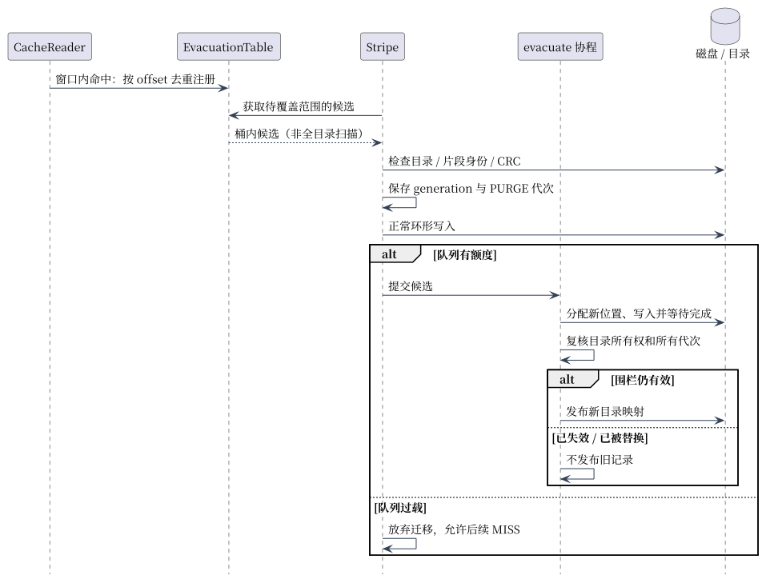

# 环形缓存热片段迁移

写指针即将覆盖已访问的片段时，尝试搬到新位置；这是有界、可放弃的保留机制，不保证永久驻留。

| 环节 | 当前实现 |
| --- | --- |
| 注册窗口 | 数据区约 10%，最少 10 MiB；读取窗口内片段时注册 |
| 索引 | offset / 4 MiB 分桶；同 offset 去重，重复命中不无限增加记录 |
| 候选查询 | 遍历覆盖范围涉及的桶及其条目；成本取决于桶数和候选数，不是严格 O(1) |
| 搬迁前 | 校验目录指向、Doc 身份/CRC、有界长度，记录 generation/PURGE 代次 |
| 后台执行 | 正常写入后进入有界 evacuation 队列；队列满可放弃，允许淘汰 MISS |
| 发布 | 新位置写入完成后，再核对原目录所有权与代次，才切换映射；已替换/失效记录不复活 |
| 与 HTTP RWW | 不等价；HTTP 只读取完整提交块，见 [RWW](rww_implementation.md) |

代码：[EvacuationTable](../cache/evacuation.go)、[Stripe](../cache/stripe.go)、[注册入口](../cache/cache_read.go)。测试：[迁移和重复注册](../cache/evacuation_test.go)、[覆盖与发布](../cache/storage_commit_test.go)。

旧原型中的 O(1)、固定倍数提升、ATS“对齐度”及覆盖率没有当前证据，已移除。当前文档不提供迁移收益跑分；原笔记可从 Git 历史查看。恢复与发布边界见 [存储格式](cache_storage_format.md)。
